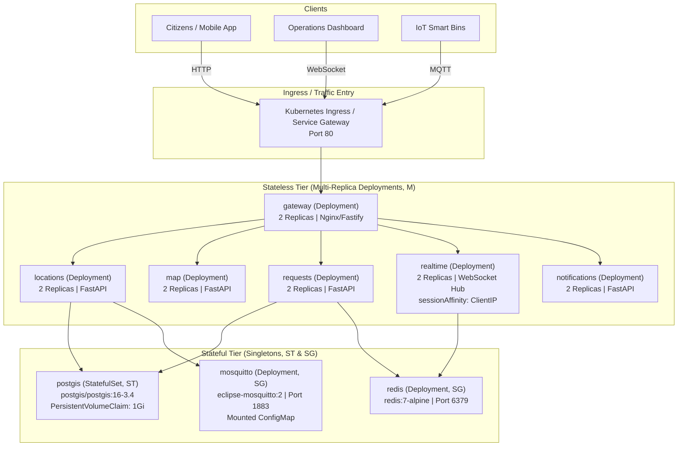

# ADR-0003: Kubernetes Orchestration Architecture & Manifest Design

- **Status:** Accepted
- **Deciders:** Distributed Waste Management System (DWMS) Platform Team
- **Date:** 2026-11-25
- **Consulted:** Architecture Cohort, Infrastructure, DevOps Teams
- **Objective:** `chore` (Platform Foundation — Feature 3)
- **Related PRs:**
  - Feature 3 IMP: PR #28 (`feature/imp-k8s-manifests`)
  - Feature 3 TEST: PR #29 (`feature/test-k8s-smoke`)

---

## 1. Context and Problem Statement

While Docker Compose provides the primary developer experience for local development, the DWMS platform requires a production-grade container orchestrator for its **Scale Milestone**. 

As a multi-tenant municipal platform serving citizens, field agents, IoT smart bins, and collection operators:
- Ingestion spikes (e.g. morning peak bin reporting, emergency overflow alerts) require horizontal auto-scaling without restarting other services.
- Microservices must be self-healing, restarting failing containers automatically and redirecting traffic away from unready pods.
- WebSocket connections to the Real-Time Hub must maintain connection affinity to prevent session drops.
- Persistent spatial data in PostGIS must survive pod crashes, node maintenance, and cluster upgrades.

A standardized, declarative Kubernetes workload architecture is required to satisfy these non-functional requirements.

---

## 2. Decision Drivers

- **Zero-Downtime Resilience:** Stateless services must support rolling zero-downtime updates and health-aware traffic routing.
- **Stateful Data Integrity:** PostGIS requires stable storage volume binding, predictable network identity, and graceful shutdown.
- **Protocol Suitability:** WebSockets (Real-Time Service) require session affinity, whereas REST APIs (Gateway, Locations, Requests) require round-robin load distribution.
- **Declarative & GitOps-Friendly:** Manifests must be modular, reproducible, and manageable without heavyweight templating runtimes for dev/staging/prod overlays.
- **Strict Boundary Scoping:** Separation between declarative manifests (IMP), health/smoke verification (TEST), and architectural governance (DOC).

---

## 3. Considered Options

1. **Option 1: Kustomize Declarative Manifests (Chosen)**
2. **Option 2: Helm Charts**
3. **Option 3: Plain Static YAML Manifests**

### Comparison Summary
| Criteria | Kustomize (Chosen) | Helm | Plain Static YAML |
| :--- | :--- | :--- | :--- |
| **Native `kubectl` Support** | Built into `kubectl apply -k` | Requires separate Helm binary | Built into `kubectl apply -f` |
| **Environment Overlays** | Native `base/` + overlays | Values files + templating engine | Requires duplicate YAML files |
| **Learning Curve** | Low (pure declarative YAML) | Medium (Go template syntax) | Minimal |
| **Drift Risk** | Low | Low | High (copy-paste drift) |

---

## 4. Decision Outcome

**Chosen Option: Option 1 — Declarative Kubernetes Architecture structured via Kustomize (`Platform/infra/k8s/`).**

### Architectural Topology (Mermaid.js)



---

## 5. Architectural Deep-Dive & Workload Classifications

Per `SUB_MODULES.md` container classifications, the Kubernetes architecture defines three workload tiers:

### 1. Stateless Multi-Replica Services (`M` & `M-sticky`)
- **Applies to:** `gateway`, `locations`, `map`, `requests`, `notifications`, `realtime`.
- **Workload Type:** `apps/v1.Deployment`.
- **High Availability:** Minimum `replicas: 2` spread across cluster nodes.
- **Health Probing Strategy:**
  - **Readiness Probe (`readinessProbe`):** Fast check (`initialDelaySeconds: 2`, `periodSeconds: 5`) against `/` or `/healthz`. Ensures traffic is only directed to pods that have completed startup.
  - **Liveness Probe (`livenessProbe`):** Failsafe check (`initialDelaySeconds: 10`, `periodSeconds: 10`) to automatically restart deadlock or hung containers.
- **Resource Guardrails:**
  - Standard container requests: `cpu: 25m`, `memory: 32Mi`.
  - Standard container limits: `cpu: 100m`, `memory: 64Mi` (protects the node from memory leaks).

### 2. WebSocket Real-Time Affinity (`M-sticky`)
- **Applies to:** `realtime` (WebSocket / SSE hub).
- **Challenge:** WebSockets establish persistent TCP connections. Unsynchronized load balancing can disconnect clients or drop active room subscriptions.
- **Architectural Solution:**
  ```yaml
  apiVersion: v1
  kind: Service
  metadata:
    name: realtime
  spec:
    sessionAffinity: ClientIP
    sessionAffinityConfig:
      clientIP:
        timeoutSeconds: 10800 # 3 hours sticky window
  ```
  `sessionAffinity: ClientIP` guarantees that multiple requests from the same client IP address are consistently routed to the same pod replica.

### 3. Stateful Spatial Persistence (`ST`)
- **Applies to:** `postgis` (PostgreSQL 16 + PostGIS 3.4).
- **Workload Type:** `apps/v1.StatefulSet`.
- **Storage Architecture:**
  - Bypasses ephemeral container storage by utilizing `volumeClaimTemplates`:
    ```yaml
    volumeClaimTemplates:
      - metadata:
          name: data
        spec:
          accessModes: ["ReadWriteOnce"]
          resources:
            requests:
              storage: 1Gi
    ```
  - Mounts to `/var/lib/postgresql/data` with dedicated `PGDATA` subpath.
- **Database Probing:**
  - Custom `exec` probes executing `pg_isready -U $POSTGRES_USER -d $POSTGRES_DB` to guarantee database readiness before dependent microservices start querying.

### 4. Managed Singletons (`SG`)
- **Applies to:** `redis` (Pub/Sub backplane & cache) and `mosquitto` (MQTT telemetry broker).
- **Workload Type:** `apps/v1.Deployment` constrained to `replicas: 1` to prevent split-brain state without cluster-mode clustering.
- **Configuration Mounting:** `mosquitto` utilizes a versioned `ConfigMap` (`mosquitto-config`) injected at `/mosquitto/config/mosquitto.conf`.

---

## 6. Security & Secret Management Integration

In initial development (Feature 3 IMP manifests in PR #28/29), credentials for PostGIS are provided via an `Opaque` Kubernetes Secret:
```yaml
apiVersion: v1
kind: Secret
metadata:
  name: postgis-credentials
type: Opaque
stringData:
  POSTGRES_USER: dwms
  POSTGRES_PASSWORD: dwms_dev
  POSTGRES_DB: dwms
```
- **Forward Compatibility:** As specified in the roadmap, **Feature 6 (Secrets management)** will replace plaintext secrets with **Bitnami SealedSecrets** or an external secret vault, encrypting sensitive credentials for safe git commits.

---

## 7. Verification & Smoke Testing (Relationship to Feature 3 TEST)

The Kubernetes manifests are validated by the automated smoke test script defined in **Feature 3 TEST** (PR #29, `Platform/tests/infra/k8s-smoke/`):
1. **Manifest Application:** Runs `kubectl apply -k Platform/infra/k8s`.
2. **Rollout Verification:** Polls `kubectl rollout status` for all 8 deployments (180 s timeout) and the PostGIS StatefulSet (240 s timeout).
3. **Pod Ready Assertion:** Asserts 100% of pods reach `Running` and `Ready` state.
4. **Replica Quorum Check:** Asserts that every stateless service has at least 2 active, ready replicas.
5. **Gateway Connectivity Probe:** Establishes a temporary port-forward to `svc/gateway` on port `18080` and curls the HTTP endpoint to confirm external reachability.

---

## 8. Summary & Team Operational Runbook

### Deploying the Stack
```bash
# Apply full DWMS Kubernetes stack
kubectl apply -k Platform/infra/k8s

# Check status of pods
kubectl -n dwms get pods -o wide

# Check services and endpoints
kubectl -n dwms get svc
```

### Teardown
```bash
kubectl delete -k Platform/infra/k8s
```
