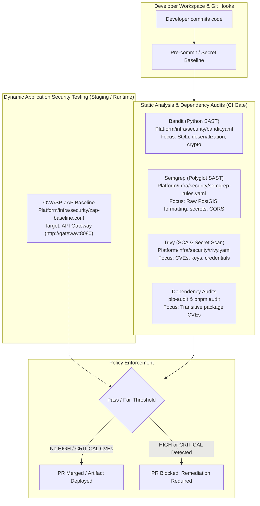

# ADR-0009: Security Scanning Strategy (SAST, DAST, SCA, and Secret Detection)

- **Status:** Accepted
- **Deciders:** Distributed Waste Management System (DWMS) Platform & Security Team
- **Date:** 2026-11-26
- **Consulted:** Architecture Cohort, DevOps, Application Leads
- **Objective:** `chore` (Platform Foundation — Feature 9)
- **Related PRs:**
  - Feature 9 IMP: `feat/chore/nammemenyoli20-sys/sast-dast`
  - Feature 9 TEST: `test/chore/nammemenyoli20-sys/scan-baseline`

---

## 1. Context and Problem Statement

The Distributed Waste Management System (DWMS) combines Python backend services (FastAPI, GeoAlchemy2), Node.js services (Fastify, WebSocket), and shared cloud infrastructure. As a public municipal system handling citizen reports, spatial waste data, and collection dispatches:

1. **Spatial Injection Risks:** Dynamic PostGIS spatial queries (bounding boxes, nearest-neighbor routing) are prone to SQL injection if unparameterized string formatting is used.
2. **Credential Leaks:** Distributed development across 120 contributors increases the risk of accidental secret commits (`.env`, private keys, API tokens).
3. **Third-Party Dependency Vulnerabilities:** Python packages (`pip`) and Node modules (`pnpm`) introduce transitive vulnerability risks (CVEs).
4. **API Security Misconfigurations:** The API Gateway must not expose permissive CORS headers, debug endpoints, or stack traces in production.

An automated, layered security scanning strategy is required to catch vulnerabilities early in the software development lifecycle (Shift-Left Security).

---

## 2. Decision Drivers

- **Shift-Left Integration:** Fast automated feedback during development and CI pull requests.
- **Polyglot Coverage:** Must evaluate both Python (FastAPI) and TypeScript (Fastify/React) codebases.
- **Zero Commercial Lock-in:** All scanning tools must be open-source and run locally as well as in GitHub Actions without proprietary licenses.
- **Low False-Positive Rate:** Must not block pull requests on harmless stylistic warnings; hard blocks must be reserved for true security risks (`HIGH` and `CRITICAL`).
- **Defense in Depth:** Combine Static Analysis (SAST), Software Composition Analysis (SCA), Dynamic Testing (DAST), and Secret Scanning.

---

## 3. Layered Security Architecture (Mermaid.js)



---

## 4. Tool Selection & Rationale

| Dimension | Selected Tool | Rationale / Alternatives Considered |
| :--- | :--- | :--- |
| **Python SAST** | **Bandit** | Standard Python AST security analyzer; detects SQL formatting, weak crypto, and dangerous subprocesses. *Alternative SonarQube rejected due to complex server infrastructure.* |
| **Polyglot SAST** | **Semgrep** | Fast semantic pattern matcher; allows custom lightweight YAML rules for DWMS-specific anti-patterns (e.g. raw PostGIS SQL). |
| **Vulnerability & Secret SCA** | **Trivy** | Fast single-binary scanner covering container images, filesystems, and secret patterns. High accuracy with low false positives. |
| **Dynamic DAST** | **OWASP ZAP** | Industry standard for web application security scanning; runs headlessly in Docker (`zaproxy/zap-stable`) with baseline alert overrides. |
| **Package Audits** | **pip-audit & pnpm audit** | Native package vulnerability checkers querying PyPI and npm advisory databases directly. |

---

## 5. Security Policies and Thresholds

### Severity Gating Matrix
- **`CRITICAL` & `HIGH` Severity:** **Hard Failure.** Blocks the pull request or deployment. Must be resolved before merge.
- **`MEDIUM` Severity:** **Warning.** Review required; can be merged if accompanied by an approved justification.
- **`LOW` & `INFO` Severity:** Informational only; logged for visibility.

### Secret Policy
- The repository strictly forbids committing `.env`, `.env.local`, `*.key`, `*.pem`, `id_rsa`, or any database credentials.
- `.env.example` is explicitly allowed as an environment variable template.

### PostGIS Spatial Query Security Rule
All queries to PostgreSQL + PostGIS must use parameterized bindings (`text("... :param")`) or GeoAlchemy2 functions. String concatenation or Python f-strings in `session.execute()` are strictly flagged as `ERROR` by Semgrep rule `dwms-avoid-raw-sql-formatting`.

---

## 6. Implementation Artifacts (Relationship to IMP & TEST)

The architecture decisions in this ADR are implemented and validated by:
- **Feature 9 IMP (`Platform/infra/security/`):**
  - `bandit.yaml`: Configures AST inspection, excluding test assertions (`B101`).
  - `semgrep-rules.yaml`: Enforces custom rules for SQL injection and secret assignment.
  - `trivy.yaml`: Sets `exit-code: 1` on `HIGH`/`CRITICAL` vulnerabilities.
  - `zap-baseline.conf`: Configures OWASP ZAP baseline rules for API Gateway.
  - `run-security-scans.sh`: Provides a unified CLI entrypoint for running scans.
- **Feature 9 TEST (`Platform/tests/infra/scan-baseline/`):**
  - `test_scan_baseline.py`: Unit and integration test suite asserting that insecure patterns are detected and configs are valid.

---

## 7. Operational Runbook

### Running SAST and Dependency Audits Locally:
```bash
bash Platform/infra/security/run-security-scans.sh --sast
```

### Running OWASP ZAP DAST against a Local Gateway:
```bash
# Ensure Gateway is running on port 8080
bash Platform/infra/security/run-security-scans.sh --dast
```

### Remediating False Positives:
If a scan flags a known non-issue (false positive):
1. Document the justification in the PR description.
2. Add an explicit exception rule to `bandit.yaml` or `zap-baseline.conf` with a link to the tracking issue.
