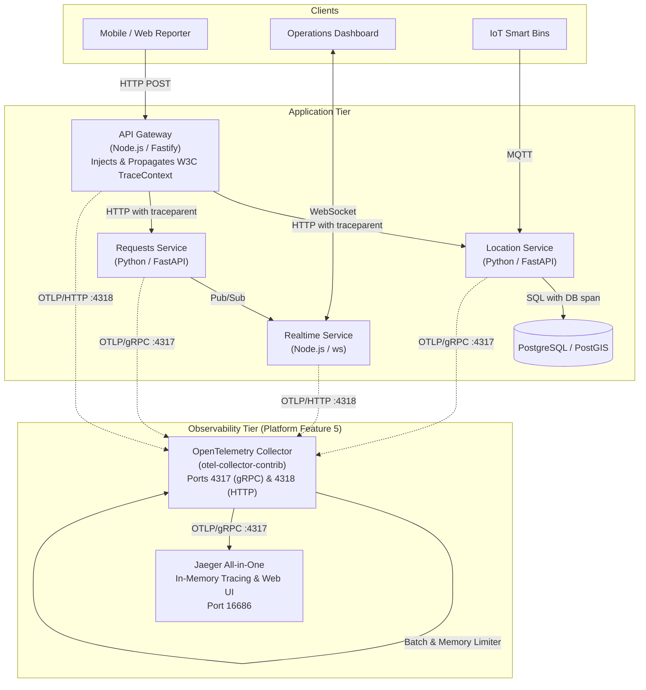

# ADR-0005: Distributed Tracing Architecture with OpenTelemetry and Jaeger

- **Status:** Accepted
- **Deciders:** Distributed Waste Management System (DWMS) Platform Team
- **Date:** 2026-11-25
- **Consulted:** Architecture Cohort, Security, Infrastructure Teams
- **Objective:** `chore` (Platform Foundation — Feature 5)

---

## 1. Context and Problem Statement

The Distributed Waste Management System (DWMS) is a cloud-native, microservices-based distributed platform. A single user or automated action traverses multiple microservices and storage tiers:
- **Location Ingestion:** Citizen/IoT/Agent $\rightarrow$ API Gateway (Fastify/Node.js) $\rightarrow$ Location Reporting Service (FastAPI/Python) $\rightarrow$ Geo Store (PostGIS) $\rightarrow$ Real-time Hub (WebSocket/Redis).
- **Collection Dispatch:** Operator $\rightarrow$ API Gateway $\rightarrow$ SPF Request Service $\rightarrow$ Notification Worker $\rightarrow$ External Dispatch.

### Challenges Without Distributed Tracing
1. **Cross-Service Visibility Deficit:** When an end-to-end request experiences high latency or intermittent failures, isolated service logs cannot correlate which downstream hop (e.g., PostGIS spatial query vs. Redis pub/sub latency) caused the bottleneck.
2. **Diagnostic Overhead:** Operators must manually match timestamps and ad-hoc log lines across separate containers.
3. **Polyglot Ecosystem:** The stack combines TypeScript/Node.js and Python. A unified tracing standard is required so trace contexts seamlessly propagate across both runtimes.

---

## 2. Decision Drivers

- **Open Standards & Vendor Neutrality:** Must not couple DWMS to any commercial observability platform (Datadog, Dynatrace, New Relic) to adhere to the zero-commercial-license rule for capstone development.
- **Polyglot Interoperability:** Native, robust SDK support for both Python (FastAPI, GeoAlchemy2) and TypeScript/Node.js (Fastify).
- **Standardized Propagation:** Industry-standard context propagation over HTTP and WebSocket protocols.
- **Decoupled Architecture:** Application services should not send traces directly to storage backends; an intermediate collector pipeline is needed to handle buffering, rate limiting, and filtering.
- **Minimal Runtime Overhead:** Asynchronous, non-blocking telemetry export with strict memory bounding.

---

## 3. Considered Options

1. **Option 1: OpenTelemetry (OTel) Collector + Jaeger Backend (Chosen)**
2. **Option 2: Direct Jaeger Client Libraries in Microservices**
3. **Option 3: Zipkin with Direct Ingestion**
4. **Option 4: Centralized Application Logging (ELK/Loki) with Correlated Request IDs**

---

## 4. Decision Outcome

**Chosen Option:** **Option 1 — OpenTelemetry (OTel) Collector with Jaeger Backend using W3C TraceContext**.

### Architectural Breakdown



### Trace Propagation Standard: W3C TraceContext

All inter-service HTTP requests propagate context via the official W3C `traceparent` header:
```text
traceparent: 00-4bf92f3577b34da6a3ce929d0e0e4736-00f067aa0ba902b7-01
              |  |                                |                |
        version  trace_id (32 hex)                parent_id (16 hex) flags (01 = sampled)
```

1. **Gateway Ingestion:** When an incoming request reaches the Gateway without a `traceparent`, the Gateway generates a fresh 32-character hex `trace_id` and root `span_id`.
2. **Forwarding:** The Gateway injects the `traceparent` header into outgoing calls to downstream services.
3. **Child Spans:** Downstream services (`locations`, `requests`) extract the context, create child spans for internal operations (e.g. spatial queries, Redis publishes), and pass the context along.

---

## 5. Pros and Cons of the Options

### Option 1: OpenTelemetry Collector + Jaeger (Selected)
- **Positive:** **Standardized & Future-Proof:** OpenTelemetry is the Cloud Native Computing Foundation (CNCF) industry standard.
- **Positive:** **Decoupled Configuration:** Microservices export to `localhost` / internal `otel-collector` via OTLP; backend storage (Jaeger, Grafana Tempo, Prometheus) can be swapped without altering microservice code.
- **Positive:** **Built-in Flow Control:** The OTel collector pipeline provides `memory_limiter` and `batch` processors to protect against trace storms.
- **Positive:** **Developer Experience:** Jaeger all-in-one provides an intuitive UI (port `16686`) for visualizing span waterfalls and latency graphs.
- **Negative:** Introduces two additional infrastructure containers (`otel-collector` and `jaeger`).

### Option 2: Direct Jaeger Client Libraries
- **Positive:** No intermediate collector container required.
- **Negative:** Legacy Jaeger SDKs are officially deprecated in favor of OpenTelemetry.
- **Negative:** Direct coupling between application code and Jaeger backend endpoints.

### Option 3: Zipkin with Direct Ingestion
- **Positive:** Lightweight and simple.
- **Negative:** Lacks the rich instrumentation ecosystem and processor pipeline capabilities of OpenTelemetry.

### Option 4: Logging-Only Correlation (Request IDs)
- **Positive:** Minimal infrastructure overhead.
- **Negative:** Fails to provide timing waterfalls, span parent-child relationships, or distributed concurrency analysis.

---

## 6. Implementation Specifications & Configuration

### OTel Collector Pipeline (`otel-collector-config.yaml`)

```yaml
receivers:
  otlp:
    protocols:
      grpc:
        endpoint: 0.0.0.0:4317
      http:
        endpoint: 0.0.0.0:4318

processors:
  batch:
    send_batch_size: 256
    timeout: 5s
  memory_limiter:
    check_interval: 2s
    limit_percentage: 80
    spike_limit_percentage: 20

exporters:
  otlp/jaeger:
    endpoint: jaeger:4317
    tls:
      insecure: true
  debug:
    verbosity: detailed

service:
  pipelines:
    traces:
      receivers: [otlp]
      processors: [memory_limiter, batch]
      exporters: [otlp/jaeger, debug]
```

### Sampling Strategy
- **Development & Staging:** `100%` sampling (`always_on`) to enable full visibility during testing and debugging.
- **Scale / Production Milestone:** Head-based probabilistic sampling (`ratio_based` at `10%` to `20%`) configured at the Gateway to bound network and memory usage under high load.

### Data Privacy & Sanitization
Per `CODE_OF_CONDUCT.md` and repository privacy guidelines:
- **No Personal Data in Attributes:** Citizen phone numbers, reporter credentials, and raw passwords must **never** be injected into span attributes.
- **Sanitized Geographic Data:** High-precision GPS coordinates are tagged to report IDs, not personal user identifiers.

---

## 7. Compliance and Verification Matrix

| Requirement | Implementation Artifact | Verification Method |
| :--- | :--- | :--- |
| **Pipeline Definition** | `Platform/infra/observability/tracing/otel-collector-config.yaml` | Validated by OTel Collector parser and Compose config. |
| **Runtime Infrastructure** | `Platform/infra/observability/tracing/docker-compose.tracing.yml` | Healthcheck verification on Jaeger (16686) and Collector (4317/4318). |
| **TraceContext Standards** | W3C `traceparent` RFC specification | `Platform/tests/infra/trace-propagation/test_trace_propagation.py` |
| **Cross-Hop Propagation** | Gateway $\rightarrow$ Backend child span creation | Automated unit & integration tests passing 100%. |

---

## 8. Summary of Migration & Team Guidelines

1. **Developers:** Configure microservices with standard environment variables (`OTEL_EXPORTER_OTLP_ENDPOINT`, `OTEL_SERVICE_NAME`).
2. **Reviewers:** Ensure PRs touching HTTP clients propagate the incoming `traceparent` header to outgoing requests.
3. **Operators:** Use the Jaeger UI at `http://localhost:16686` to diagnose latency bottlenecks.
