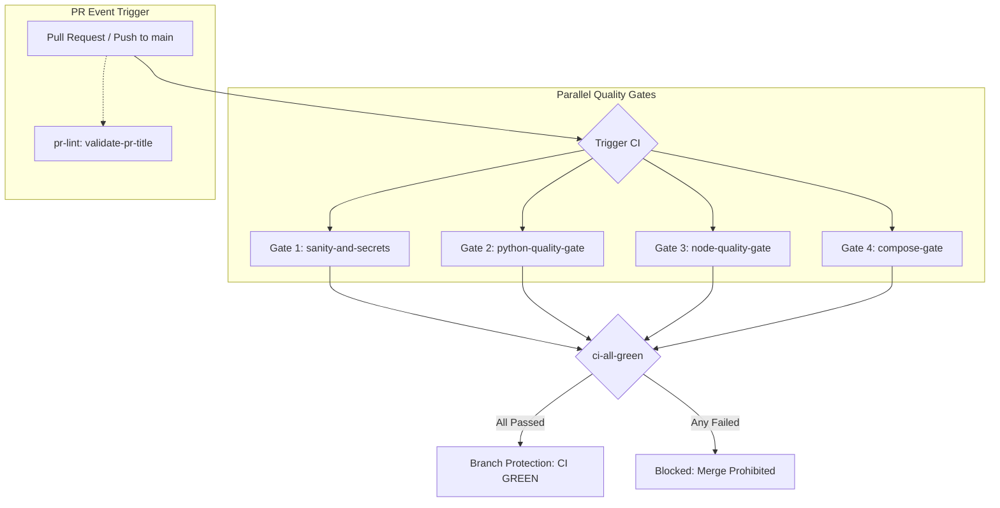

# Continuous Integration (CI) Pipeline Guide

> **Developer Guide for DWMS CI/CD Quality Gates & Automated Validation**  
> *Target audience: DWMS Developers, Sub-module Implementers, Reviewers, and Instructors.*

---

## Table of Contents

1. [Executive Overview](#1-executive-overview)
2. [CI Architecture & Job Dependency Graph](#2-ci-architecture--job-dependency-graph)
3. [Quality Gates In-Depth](#3-quality-gates-in-depth)
   - [Gate 1: Sanity, Secrets & YAML Syntax](#gate-1-sanity-secrets--yaml-syntax)
   - [Gate 2: Python Ecosystem Quality Gate](#gate-2-python-ecosystem-quality-gate)
   - [Gate 3: Node / TypeScript Ecosystem Quality Gate](#gate-3-node--typescript-ecosystem-quality-gate)
   - [Gate 4: Docker Compose Orchestration Gate](#gate-4-docker-compose-orchestration-gate)
   - [Gate 5: Semantic PR Title & Standards Gate](#gate-5-semantic-pr-title--standards-gate)
   - [Gate 6: Consolidated All-Green Gate](#gate-6-consolidated-all-green-gate)
4. [Local Developer Runbook (Pre-Push Checklist)](#4-local-developer-runbook-pre-push-checklist)
5. [Troubleshooting Matrix & Failure Recovery](#5-troubleshooting-matrix--failure-recovery)
6. [Branch Protection & Merging Rules](#6-branch-protection--merging-rules)

---

## 1. Executive Overview

The Distributed Waste Management System (DWMS) operates as a distributed, polyglot microservices platform. Because over 30 parallel teams and up to 120 contributors push changes across Python services (`locations`, `map`, `requests`, `notifications`), TypeScript services (`gateway`, `realtime`, `dashboard`, `reporter`), and shared infrastructure (`Platform/`), automated quality control is paramount.

The CI pipeline is designed around three non-negotiable principles:
- **Zero-Baseline Agility:** The pipeline gracefully succeeds on empty scaffolding, automatically triggering strict lint, type-check, and test gates as files and manifests are introduced.
- **Fail Fast, Fail Informatively:** Independent jobs run in parallel on isolated GitHub Actions runners (`ubuntu-latest`), failing early with actionable annotations.
- **Strict Boundary Enforcement:** Validates secrets, syntax, schemas, and PR naming conventions before code is merged into `main`.

---

## 2. CI Architecture & Job Dependency Graph

The CI workflows live in `.github/workflows/`:
- **`ci.yml`**: Main validation workflow executing across pushes and pull requests targeting `main`.
- **`pr-lint.yml`**: Semantic pull request validator running on PR title events.

### Workflow Execution Flowchart



### Concurrency and Resource Optimization

```yaml
concurrency:
  group: ${{ github.workflow }}-${{ github.ref }}
  cancel-in-progress: ${{ github.event_name == 'pull_request' }}
```
When a developer pushes multiple commits in quick succession to a pull request, stale CI runs are automatically cancelled, conserving GitHub Actions minutes and providing immediate feedback on the newest commit.

---

## 3. Quality Gates In-Depth

### Gate 1: Sanity, Secrets & YAML Syntax
- **Job ID:** `sanity-and-secrets`
- **Runner:** `ubuntu-latest`
- **What it checks:**
  1. **Secrets Detection:** Scans the repository tree using `find` for forbidden secret files such as `.env`, `.env.local`, `*.key`, `*.pem`, or private SSH keys. The file `.env.example` is explicitly allowed as an environment template.
  2. **YAML Syntax Validation:** Recursively loads all `.yml` and `.yaml` files in the repository using Python's `yaml.safe_load()` to ensure no hard tabs, indentation errors, or unclosed braces pass unnoticed.

### Gate 2: Python Ecosystem Quality Gate
- **Job ID:** `python-quality-gate`
- **Environment:** Python 3.11+
- **Applies to:** `services/locations`, `services/map`, `services/requests`, `services/notifications`, `simulator/*`, and Python scripts.
- **Quality Steps:**
  1. **File Detection:** Evaluates `find . -name "*.py"`. If zero Python files exist, the job passes cleanly.
  2. **Linting & Formatting:**
     ```bash
     ruff check .
     ruff format --check .
     ```
     Enforces PEP 8 compliance, import sorting, and zero unused imports or syntax smells.
  3. **Static Type Checking:**
     ```bash
     mypy --ignore-missing-imports .
     ```
     Guarantees static type safety across services.
  4. **Automated Testing:**
     ```bash
     pytest -v
     ```
     Executes unit and integration test suites asynchronously via `pytest-asyncio` and `httpx`.

### Gate 3: Node / TypeScript Ecosystem Quality Gate
- **Job ID:** `node-quality-gate`
- **Environment:** Node.js 20 LTS, pnpm 9
- **Applies to:** `services/gateway`, `services/realtime`, `frontend/dashboard`, `frontend/reporter`.
- **Quality Steps:**
  1. **Dynamic Package Discovery:** Searches for all `package.json` files outside `node_modules`.
  2. **Dependency Resolution:** Installs dependencies cleanly using `pnpm install --frozen-lockfile`.
  3. **Conditional Execution:**
     - Runs `pnpm run lint` if an ESLint script is defined.
     - Runs `pnpm run typecheck` (`tsc --noEmit`) to verify TypeScript typings.
     - Runs `pnpm test` (`vitest`) to execute frontend and Node microservice test suites.

### Gate 4: Docker Compose Orchestration Gate
- **Job ID:** `compose-gate`
- **Tooling:** Docker Compose v2 CLI
- **Applies to:** Root `docker-compose.yml`, `Platform/infra/compose/`, and environment overlays.
- **Quality Steps:**
  - Discovers all compose files matching `docker-compose*.yml` or `compose*.yml`.
  - Runs:
    ```bash
    docker compose -f <file> config > /dev/null
    ```
  - Verifies service definitions, network bridges (`dwms-net`), named volume declarations (`postgis_data`, `redis_data`), environment variable substitutions, and dependency ordering (`condition: service_healthy`).

### Gate 5: Semantic PR Title & Standards Gate
- **Workflow:** `.github/workflows/pr-lint.yml`
- **Tooling:** `amannn/action-semantic-pull-request@v5`
- **Allowed Types:** `feat`, `fix`, `docs`, `style`, `refactor`, `perf`, `test`, `build`, `ci`, `chore`, `revert`, `adr`, `WIP`
- **Examples of Valid PR Titles:**
  - `feat(obj1): implement waste report ingestion endpoint`
  - `fix(obj2): adjust road condition line styles in palette`
  - `chore(ci): implement GitHub Actions quality gates`
  - `test(chore): implement test suite for CI quality gates`
  - `WIP: docs/chore/NKENG-FRANK/ci-guide`

### Gate 6: Consolidated All-Green Gate
- **Job ID:** `ci-all-green`
- **Purpose:** Acts as a single, unified barrier depending on all four parallel jobs (`sanity-and-secrets`, `python-quality-gate`, `node-quality-gate`, `compose-gate`). This is the status check specified in repository branch protection settings to prevent merging defective branches.

---

## 4. Local Developer Runbook (Pre-Push Checklist)

Before running `git push` to your feature branch, execute these steps locally to avoid failing CI builds:

### Step 1: Scan for Staged Secrets
```bash
# Verify no .env or key files are staged
git status
```
*Never commit `.env`. Always copy `.env.example` to `.env` locally.*

### Step 2: Validate Python Code Quality
```bash
# Lint and format
ruff check .
ruff format .

# Strict type checking
mypy .

# Run test suite
pytest -v
```

### Step 3: Validate TypeScript & Node Code Quality
```bash
cd services/<service_name>  # or frontend/<app_name>
pnpm run lint
pnpm run typecheck
pnpm test
```

### Step 4: Validate Docker Compose Configurations
```bash
docker compose config
```

---

## 5. Troubleshooting Matrix & Failure Recovery

| CI Failure Symptom | Likely Cause | Solution / Fix Command |
| :--- | :--- | :--- |
| **`Found forbidden sensitive file(s)`** | A `.env`, `.key`, or `.pem` file was committed. | Remove from git: `git rm --cached <file>`, add to `.gitignore`, and amend commit. |
| **`YAML error in ...`** | Hard tab character or mismatched braces in a YAML file. | Replace tabs with spaces (2-space indent). Validate with Python `yaml.safe_load()`. |
| **`ruff format check failed`** | Python file does not match Ruff code formatting rules. | Run `ruff format .` locally and commit the formatted files. |
| **`mypy failed with type errors`** | Type mismatch or missing argument in a typed function. | Inspect mypy error line, add or correct Python type hints, and re-run `mypy .`. |
| **`compose config syntax error`** | Indentation error or invalid field in `docker-compose.yml`. | Run `docker compose config` locally to see the exact line error. |
| **`PR title validation failed`** | PR title does not use Conventional Commits format. | Edit PR title on GitHub to start with `feat:`, `fix:`, `chore:`, `test:`, `docs:`, etc. |

---

## 6. Branch Protection & Merging Rules

1. **Required Status Checks:**
   - The status check **`All CI Quality Gates Passed`** (`ci-all-green`) must be green.
   - The PR title linter must pass.
2. **Linear History:** Rebase onto `upstream/main` rather than creating merge commits.
3. **Traceability:** Fill out every section of `.github/PULL_REQUEST_TEMPLATE.md` with objective checkboxes, testing proof, and AI disclosures.
