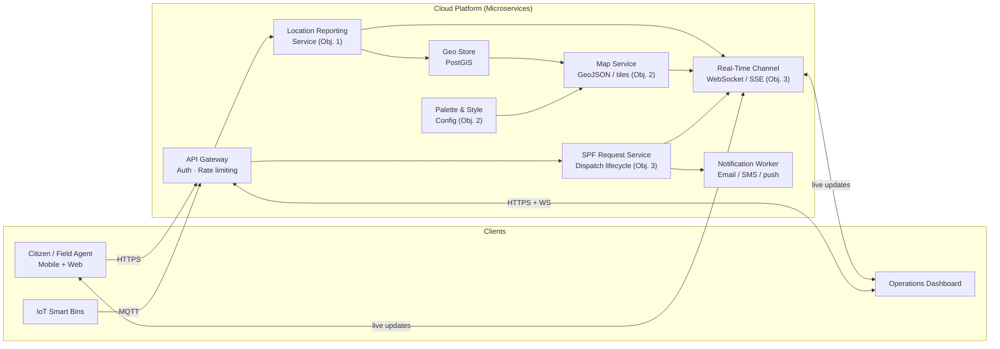

# Distributed Waste Management System (DWMS)

[](LICENSE)
[](CONTRIBUTING.md)
[]()

> A cloud‑native, microservices‑based platform that **geolocates waste in real time**, renders it on a **color‑coded map** encoding waste volume and road accessibility, and exposes a **cloud service to view, update, and dispatch SPF collection requests** from any device.

---

## Table of Contents

- [Project Objectives](#project-objectives)
- [Glossary](#glossary)
- [Architecture Overview](#architecture-overview)
- [Map & Color Palette Specification](#map-color-palette-specification)
- [Key Features](#key-features)
- [Technology Stack](#technology-stack)
- [Repository Structure](#-repository-structure)
- [Getting Started](#getting-started)
- [Usage & Scenarios](#usage--scenarios)
- [How to Contribute (Students & Forks)](#how-to-contribute-students--forks)
- [Roadmap & Milestones](#roadmap--milestones)
- [Scaling Limits & Where This Breaks](#scaling-limits--where-this-breaks)
- [License](#license)
- [Acknowledgements](#acknowledgements)

---

## Project Objectives

This capstone is defined by three objectives. Every service, endpoint, and map style must trace back to at least one of them.

| # | Objective | What it means in practice | Primary deliverables |
|---|-----------|---------------------------|----------------------|
| **1** | **Collect waste‑location information** | Capture the geographic position of waste deposits plus descriptive attributes (estimated volume/amount, waste type, timestamp, reporter) from multiple sources: field agents, citizens, and IoT/smart‑bin sensors. | Location Reporting Service, mobile/web reporting form, ingestion API, PostGIS storage |
| **2** | **Produce a color‑coded map of waste volume and road condition** | Render all reported waste locations on an interactive map using a **defined, documented color palette** that encodes *how much* waste is present and *how accessible* the road leading to it is. | Map Service (GeoJSON/tiles), styling spec, legend component, road‑condition data model |
| **3** | **Provide a cloud service to view, update the map and request the SPF in real time** | A multi‑tenant cloud API + live channel allowing clients to (a) view the current map, (b) create/modify waste and road reports, and (c) submit a collection request to the **SPF** for a specific waste location and track its status without page refresh. | API Gateway, SPF Request Service, real‑time channel (WebSocket/SSE), dashboard |

> **Traceability rule:** every pull request should state which objective(s) it advances. Use the PR template field *"Objective(s): 1 / 2 / 3"*.

---

## Glossary

| Term | Meaning |
|------|---------|
| **Waste location** | A georeferenced point (or small polygon) where waste has been deposited or accumulated, with attributes: estimated amount, waste type, reporter, timestamp, status. |
| **Road condition** | The accessibility of the road/path serving a waste location (e.g., *good/paved*, *degraded*, *unpaved*, *impassable*). Determines which vehicle can service it. |
| **SPF** | The **waste‑collection service provider** — the operator responsible for physically collecting waste (e.g., the municipal cleansing service). Requests are dispatched to the SPF from this platform. |
| **SPF request** | A formal, timestamped dispatch of the SPF to a specific waste location, with a lifecycle: `REQUESTED → ASSIGNED → IN_PROGRESS → COLLECTED` (or `REJECTED` / `CANCELLED`). |
| **Amount / volume bucket** | A coarse classification of waste quantity (see [palette spec](#map--color-palette-specification)) rather than a precise measurement, to keep field reporting fast. |

---

## Architecture Overview

DWMS is a **cloud‑hosted microservice platform** with an optional edge tier for sensor capture. Services are independently deployable so ingestion volume, map rendering load, and request‑tracking traffic can scale separately.



---

|Service | Objective | Responsibility |
|------|---------|------------------|
| API Gateway | 1, 2, 3 | Single entry point; authentication, authorization, rate limiting, request routing. |
| Location Reporting Service | 1 | Validates and stores waste reports (coordinates, amount bucket, waste type, reporter, timestamp, photos). |
| Geo Store (PostGIS) | 1, 2 | Spatial persistence and querying: bounding‑box queries, nearest‑neighbour, viewport filtering. |
| Map Service | 2 | Serves viewport‑scoped GeoJSON / map tiles and applies the palette and road‑condition styling. |
| Palette & Style Config | 2 | Single source of truth for the color palette; versioned so map styling is reproducible. |
| SPF Request Service | 3 | Creates SPF requests for specific waste locations, manages the request lifecycle, records assignment/completion. |
| Real‑Time Channel | 3 | Pushes map diffs and request status changes to subscribed clients (WebSocket / SSE). |
| Notification Worker | 3 | Delivers SPF dispatches and status changes via email/SMS/push (async, decoupled). |

---

## Map-color-palette-specification

Objective 2 requires a specific, documented palette. It encodes two independent dimensions on one map, so the team must avoid colour confusion between them. The approach: waste amount is encoded by marker fill colour; road condition is encoded by the road segment's line style and colour. This keeps the two encodings on different visual channels (fill vs. stroke/pattern), which is more readable and more accessible than mixing them in one colour ramp.

### Dimension A — Waste amount (marker fill)

| Bucket | Range (estimated) | Colour | Hex |
|---------|---------|---------|---------|
| Empty / clear | 0–10 % | Green | #2E7D32 |
| Low | 11–40 % | Light amber | #F9A825 |
| Moderate | 41–70 % | Orange | #EF6C00 |
| High | 71–90 % | Red | #C62828 |
| Overflow | > 90 % or flagged | Deep purple | #6A1B9A |
| Unknown / stale | No report > 7 days | Grey, 50 % opacity | #9E9E9E |

### Dimension B — Road condition (serving road segment)

| Condition | Line style | Colour | Hex |
|---------|---------|---------|---------|
| Good / paved| Solid, 3 px | Dark green | #1B5E20 |
| Degraded | Dashed, 3 px | Dark amber | #F57F17 |
| Unpaved / dirt track | Dotted, 3 px | Brown | #6D4C41 |
| Impassable / blocked | Cross‑hatch overlay | Dark red | #B71C1C |

### Rules and constraints

---

+ Legend is mandatory on every map view; both dimensions must be legible without hovering.
+ Redundant encoding for accessibility: amount buckets also differ by marker size and shape glyph; road conditions also differ by pattern, so the map remains readable for colour‑vision‑deficient users and in greyscale print.
+ Palette is versioned in *services/map/style/palette.json*; changes require an ADR in *docs/architecture/adr/*.
+ Staleness matters: a report older than the configured TTL renders greyed out, because a colour implying "overflow" must not be trusted indefinitely.
+ Clipping: viewport queries must be spatially indexed so palette rendering cost stays flat as the number of waste locations grows.

---

## Key features

### Objective 1 — Collection

+ Multi‑source reporting: field‑agent mobile form, citizen web form, and IoT/smart‑bin telemetry.
+ GPS capture plus manual pin‑drop fallback for low‑accuracy devices.
+ Offline‑first reporting for field agents with deferred sync.
+ Waste attributes: estimated amount bucket, waste type, photo evidence, reporter identity, timestamp.

### Objective 2 — Mapping

+ Interactive map with viewport‑scoped GeoJSON loading.
+ Documented, versioned palette encoding waste amount and road condition simultaneously.
+ Filtering by amount bucket, road condition, waste type, freshness, and request status.
+ Clustering at low zoom to keep the map responsive in dense areas.

### Objective 3 — Cloud service & real‑time

+ Authenticated REST API to view the map, create/update waste and road reports, and request the SPF for a specific waste location.
+ Real‑time propagation: new reports, edits, and SPF status changes appear on connected clients without refresh (WebSocket/SSE).
+ Full SPF request lifecycle with audit trail: *REQUESTED → ASSIGNED → IN_PROGRESS → COLLECTED, plus REJECTED / CANCELLED*.
+ Multi‑tenant separation (municipality / district) so each authority sees only its jurisdiction.

This section is the specification. The implementation and any refinements belong in *docs/architecture/adr/* and *services/map/style/*.

---

## Technology Stack

| Layer | Suggested Technologies (students may propose alternatives) |
|---------|------------------------------------------|
| API Gateway | Node.js (Express/Fastify) or Go |
| Microservices| Python (FastAPI) or Node.js |
| Spatial storage | PostgreSQL + PostGIS |
| Map rendering | MapLibre GL JS / Leaflet + vector or GeoJSON layers |
| Real‑time	WebSocket | (Socket.IO / ws) or Server‑Sent Events |
| Messaging (async)	| Redis Pub/Sub or Apache Kafka |
| IoT ingestion	| MQTT broker (Mosquitto) |
| Containerisation | Docker · Docker Compose |
| Orchestration	| Kubernetes (for the scale milestone) |
| Frontend | React + MapLibre GL JS |
| Cloud target | AWS / Azure / GCP, or local Docker for development |

PostGIS is strongly recommended over a generic document store: viewport queries, nearest‑waste‑to‑vehicle, and road‑segment joins are exactly what it is built for.

---

## 📁 Repository Structure

```text

distributed-waste-management/
├── README.md
├── LICENSE
├── CONTRIBUTING.md
├── docker-compose.yml
├── .github/
│   └── PULL_REQUEST_TEMPLATE.md      # includes "Objective(s): 1 / 2 / 3"
├── docs/
│   ├── architecture/
│   │   └── adr/                      # palette changes, storage choices, etc.
│   ├── api/                          # OpenAPI specs per service
│   └── runbooks/
├── services/
│   ├── gateway/                      # API gateway
│   ├── locations/                    # Objective 1 — reporting & ingestion
│   ├── map/                          # Objective 2 — GeoJSON/tiles + styling
│   │   └── style/
│   │       └── palette.json          # versioned palette (single source of truth)
│   ├── requests/                     # Objective 3 — SPF request lifecycle
│   ├── realtime/                     # Objective 3 — WebSocket/SSE hub
│   └── notifications/                # dispatch & status notifications
├── simulator/
│   ├── iot_bins/                     # bin telemetry simulator
│   └── field_reports/                # scripted waste-location generator
├── frontend/
│   ├── dashboard/                    # operations map + SPF queue
│   └── reporter/                     # citizen / field-agent reporting app
├── infrastructure/
│   ├── k8s/
│   └── terraform/
└── tests/
    ├── integration/
    └── e2e/
