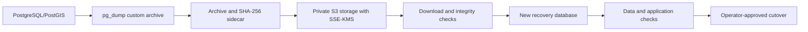

# ADR-0008: Database backups and recovery

- Status: Proposed; maintainer acceptance and production provisioning pending
- Feature: 8 — Backup & DR
- Objective: `chore`
- Related dependency: Feature 1 — Compose orchestration

## Context

DWMS stores spatial reports and collection requests in separate schemas of a
PostgreSQL/PostGIS database. The team needs a recovery procedure that can run
before Kubernetes or a cloud deployment is available.
The catalogue classifies Feature 8 as CI+MS, with no dedicated runtime container.

## Decision

Use the database container's matching PostgreSQL clients to create a compressed
custom-format full-database archive. Implement orchestration with Python 3.11's
standard library; use argument lists and binary streams without a shell or TTY.
No API endpoint or new application service is introduced, so OpenAPI is not
applicable to this infrastructure module.

Pair each archive with a SHA-256 sidecar and verify before restoration. Restore
only into a newly created `dwms_restore_` database, using a single transaction,
with no automatic database deletion, ownership restoration or ACL restoration.
Provision roles/grants separately and require operator validation before cutover.

Provide explicit AWS CLI v2 transfers to operator-provisioned S3 storage using
SSE-KMS. Use private versioned storage and unique keys. No production secrets,
cloud resource creation, production schedule or retention deletion is included.
S3 is the proposed managed-storage integration, subject to maintainer approval.

Use PostgreSQL 16 / PostGIS 3.4 in isolated CI recovery drills, matching the
contribution guide's baseline. Feature 1's unmerged scaffold proposes a different
image version; reconcile this before production acceptance. Container-provided
clients avoid assuming a host PostgreSQL version, but do not guarantee arbitrary
cross-version recovery.

## Alternatives considered

Volume copies require coordinated snapshots and a storage-specific consistency
procedure. Kubernetes-only backup operators would make early recovery depend on
a cluster. WAL archiving provides point-in-time recovery but requires additional
storage, retention, monitoring and restore design. Reconsider WAL archiving if
measured logical-backup recovery cannot meet approved targets.

## Consequences

The tests run without the application services. Recovery requires a trusted
archive, compatible extensions, enough storage and an operator to validate the
database and switch application connections. External media needs its own recovery
procedure.
SHA-256 detects corruption, not malicious replacement. S3 IAM/KMS behavior must
be verified in an authorized cloud environment; the local tests do not exercise
the cloud account.

Proposed RPO/RTO are six hours/sixty minutes, pending representative measurements.
Global roles, tablespaces, Redis/MQTT state and external media are excluded. Logical
snapshots do not support recovery to arbitrary intermediate timestamps.

## Acceptance

Accept after unit checks, a real PostGIS recovery drill, successful offsite
upload/download with approved policies, measured recovery timing and maintainer
review. Follow the [recovery runbook](../../runbooks/backup-dr.md).

The [tutorial](../../guides/backup-dr-tutorial.md) demonstrates recovery with sample
data. The [requirement review](../../assessment/feature8-requirements.md) links each
role's deliverables and records the remaining acceptance work.
