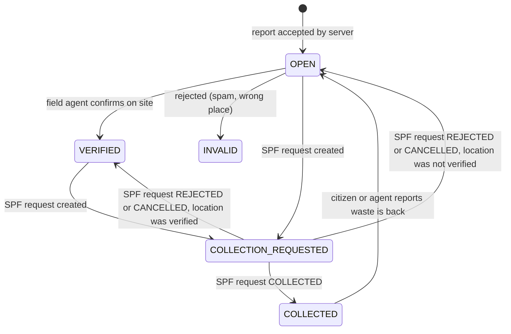

# Functional Requirements: Citizen and Field Agent Application (Mobile and Web)

| Item | Detail |
|------|--------|
| Project | Distributed Waste Management System (DWMS) |
| Component | Citizen / Field Agent Mobile + Web (`frontend/reporter`) |
| Course | CS 4122, Distributed Systems and Cloud Computing, ICT University |
| Document status | Draft 0.1, submitted for review |
| Date | 16 November 2026 |
| Author | Dejon Fah Joel Xavier |
| Objectives served | 1 (primary), 2 and 3 (as a client of the map and SPF services) |

---

## 1. Purpose and scope

This document lists the **functional requirements** of the Citizen and Field Agent application: the client through which citizens and field agents report waste and road conditions, view the colour-coded map, and follow SPF collection requests. It is based on the project README (objectives, glossary, palette specification, usage scenarios) and CONTRIBUTING.md (technology stack and rules).

The application is a client only. Storage of reports, spatial queries, map data generation, authentication, dispatch to the SPF and notification delivery belong to the platform services described in the README; this document states only what the application must do with them.

Non-functional requirements are deliberately out of scope for this file and will be proposed separately, so that this pull request stays small and focused on one concern.

### 1.1 Conventions

- "shall" = mandatory, "should" = desirable, "could" = optional.
- Priority (Pri) uses MoSCoW: **M** must, **S** should, **C** could.
- Obj = project objective from the README (1, 2, 3).
- Each acceptance criterion is a single observable check that a reviewer or a test can confirm.
- Numeric values marked *(prov.)* are provisional and open to review.

### 1.2 Actors

| Actor | Description |
|-------|-------------|
| Visitor | Anyone who opens the application without logging in. |
| Citizen | Registered member of the public who reports waste and road problems and follows the outcome. |
| Field agent | Municipal or SPF staff member whose account is created by an administrator; works outdoors, often offline. |

Operators, SPF agents and administrators use the Operations Dashboard and are outside the scope of this document.

### 1.3 Waste-location status as seen by the reporter

The application displays the status owned by the Location Reporting Service. The values below are a proposal, to be confirmed with the Location Reporting Service (Section 3).

| State | Meaning |
|-------|---------|
| OPEN | A report was accepted by the server: waste is present at this location. |
| VERIFIED | A field agent has confirmed on site that the waste is real. |
| INVALID | The report was wrong (spam, wrong place). It is hidden from the public map but kept, never deleted silently. |
| COLLECTION_REQUESTED | An SPF request exists and is not finished (request status REQUESTED, ASSIGNED or IN_PROGRESS). |
| COLLECTED | The SPF request reached COLLECTED: the waste has been removed. |

| Transition | Trigger | Requirements |
|------------|---------|--------------|
| (start) to OPEN | The server accepts a submitted report. | FR-RA-23 |
| OPEN to VERIFIED, OPEN to INVALID | A field agent checks the report on site and confirms or rejects it with a reason. | FR-RA-27 |
| OPEN or VERIFIED to COLLECTION_REQUESTED | An authorised user creates an SPF request. | FR-RA-54 |
| COLLECTION_REQUESTED to COLLECTED | The SPF marks the request COLLECTED. | FR-RA-53 |
| COLLECTION_REQUESTED to OPEN or VERIFIED | The SPF request is rejected or cancelled. The location returns to the state it had before the request, so a field agent's verification is not lost and the waste stays visible on the map. | FR-RA-53 |
| COLLECTED to OPEN | The original reporter or a field agent reports that the waste is still there or has come back. | FR-RA-58 |

Two rules complete the diagram:

- A report that is still in the device outbox has no server status yet. It is shown with its outbox state (queued, sending, failed), never with one of the states above.
- Staleness is not a state. A location with no report or confirmation for longer than the staleness threshold (7 days per the README) is drawn grey on the map whatever its state (FR-RA-47).

---

## 2. Functional requirements

### 2.1 Account and access

| ID | Requirement | Obj | Pri | Acceptance criterion |
|----|-------------|-----|-----|----------------------|
| FR-RA-01 | The application shall allow a visitor to register as a citizen with **either** a mobile phone number **or** an email address, plus a password, and shall verify the chosen identifier with a one-time code before the account becomes active. | 1 | M | A new phone number or email, once verified by code, can log in; an unverified one cannot; a duplicate is refused. |
| FR-RA-02 | The application shall allow a registered user to log in and obtain an access token from the API Gateway; on failure the message shall not reveal which field was wrong. | 1, 3 | M | Valid credentials open a session; invalid ones show a generic error. |
| FR-RA-03 | The application should allow a citizen to register and log in with a Google account (OpenID Connect) as an alternative to phone or email. The first social login shall show the purpose-and-consent screen and shall request only name, email and email-verified status. Social login shall not be available for field agent accounts. | 1 | S | A citizen signs in with Google and gets the citizen role; a field agent account cannot use Google sign-in; with Google unreachable, phone and email login still work. |
| FR-RA-04 | If a social login's email matches an existing account, the application shall require the user to log in with that account's existing method before linking the two. | 1 | S | Signing in with Google using an already-registered email asks for the existing login first and creates no second account. |
| FR-RA-05 | The application shall allow a user who forgot their password to reset it using a one-time code sent to their verified phone number or email. | 1 | M | After the reset flow, the old password no longer works and the new one does. |
| FR-RA-06 | The application shall offer no self-registration for the field agent role. | 1 | M | No sign-up path assigns the field agent role. |
| FR-RA-07 | The application shall keep the session across browser restarts until the refresh token expires or the user logs out. | 1 | M | Reopening the browser within the refresh lifetime keeps the user logged in. |
| FR-RA-08 | The application shall show or hide functions according to the role claim in the token. The server remains the authority for every permission. | 1, 3 | M | A citizen sees no field-agent controls; a field-agent call made with a citizen token is refused by the server. |
| FR-RA-09 | The application shall display only the data of the authenticated user's jurisdiction, as returned by the server. | 3 | M | With two seeded jurisdictions, a user of one never sees records of the other. |
| FR-RA-10 | On logout, the application shall delete tokens and cached personal data from the device, and shall warn the user first if the outbox still holds unsent reports. | 1 | S | After logout no token or cached personal data remain; a warning appears if the outbox is not empty. |
| FR-RA-11 | The application shall allow a citizen to request deletion of their account and to download a copy of their own reports. | 1 | S | A deletion request is acknowledged and the account can no longer log in; the export contains the user's reports and nothing else. |
| FR-RA-12 | The application could allow a visitor to view the public map in read-only mode without an account. Reporting and SPF functions shall still require login. | 2 | C | A visitor sees the map and legend but every reporting control leads to the login screen. |

### 2.2 Waste-location reporting (Objective 1)

| ID | Requirement | Obj | Pri | Acceptance criterion |
|----|-------------|-----|-----|----------------------|
| FR-RA-13 | The application shall capture the device position and its accuracy radius when the user starts a report, and shall warn the user when the radius exceeds a configurable threshold *(prov. 50 m)*. | 1 | M | With permission granted, position and accuracy fill the form; a fix above the threshold shows a warning. |
| FR-RA-14 | The application shall let the user set or correct the position by placing a pin on the map, with or without a device fix. | 1 | M | With location permission denied, the submitted coordinates equal the pin position. |
| FR-RA-15 | The application shall require exactly one amount bucket (empty, low, moderate, high, overflow), each shown with its palette colour, glyph and a short visual description. "Unknown / stale" shall not be selectable. | 1, 2 | M | The form cannot be submitted without a bucket; exactly five are offered. |
| FR-RA-16 | The application shall require one waste type from the list provided by the Location Reporting Service. | 1 | M | The options equal the list returned by the service. |
| FR-RA-17 | The application shall allow up to three photographs per report *(prov.)*, taken with the camera or chosen from the device. A photograph shall be optional for citizens and mandatory for field agents. | 1 | M | A citizen can submit without a photo; a field agent cannot; a fourth photo is refused. |
| FR-RA-18 | The application shall allow an optional note of at most 500 characters *(prov.)* and an optional "hazardous waste" flag that displays a do-not-touch caution. | 1 | S | A 501-character note is refused; setting the flag shows the caution. |
| FR-RA-19 | The application shall record the capture time from the device and send it separately from the receipt time assigned by the server. | 1 | M | A report made offline carries a capture time earlier than its receipt time. |
| FR-RA-20 | The application shall validate the report before sending it (required fields, coordinate ranges, note length, photo type and size) and shall name the field at fault. | 1 | M | Each invalid case is blocked with a message naming the field. |
| FR-RA-21 | Before submission, the application shall show active waste locations within a configurable radius *(prov. 25 m)* and offer three choices: **confirm** that an existing one is still there, **update** it, or **create** a new location. | 1 | S | A report inside the radius shows the nearby location(s) and the three choices. |
| FR-RA-22 | When the user confirms an existing location, the application shall send a confirmation (not a new location), which refreshes the location's last-report time so that it does not turn stale. | 1, 2 | S | After a confirmation, the location's last-report time changes and no new location is created. |
| FR-RA-23 | After the server accepts a report, the application shall display its identifier and status. A queued report shall never be shown as accepted. | 1 | M | The confirmation appears only after the server's acceptance response. |
| FR-RA-24 | The application shall list the user's own reports with their current status (Section 1.3) and outbox state. | 1 | M | The list shows the user's reports with status and none of other users. |
| FR-RA-25 | The application should allow a reporter to withdraw their own report while its status is OPEN and it has not been verified. | 1 | C | An OPEN, unverified report can be withdrawn; a verified one cannot. |
| FR-RA-26 | The application shall allow a field agent to update the amount bucket of a location in their jurisdiction. The update is recorded as a new entry in the location history; earlier entries are kept. | 1, 2 | M | After an update, the history shows both the old and the new entry. |
| FR-RA-27 | The application should allow a field agent to mark a citizen report as **verified** or **invalid** (with a reason) after checking it on site. | 1 | S | A verified report shows a verified badge; an invalid one disappears from the public map and shows the reason to its reporter. |
| FR-RA-28 | The application could provide a survey mode for field agents in which the waste type and jurisdiction are kept between reports, so that several locations can be recorded in a row. | 1 | C | In survey mode, the second report opens with the previous waste type preselected. |

### 2.3 Road-condition reporting (Objectives 1 and 2)

| ID | Requirement | Obj | Pri | Acceptance criterion |
|----|-------------|-----|-----|----------------------|
| FR-RA-29 | The application shall allow the user to select a road segment on the map and report its condition as one of the four palette values: good/paved, degraded, unpaved, impassable. | 1, 2 | M | Exactly four values are offered and the report carries the segment identifier. |
| FR-RA-30 | The application should allow a photograph and a note on a road-condition report, and could allow linking it to the waste location the road serves. | 1, 2 | S | The photo, the note and the link appear in the report detail. |
| FR-RA-31 | The application shall show each road-condition report as unverified until the server marks it verified. | 1 | S | A new report shows "unverified"; it shows "verified" after the server changes it. |
| FR-RA-32 | When the road segment is missing from the map, the application could allow the user to drop a pin and describe the road, sending it as an "unmapped road" report for an operator to review. | 1 | C | An unmapped-road report reaches the server with a point and a description, and is not drawn as a road segment. |

### 2.4 Offline operation and synchronisation

| ID | Requirement | Obj | Pri | Acceptance criterion |
|----|-------------|-----|-----|----------------------|
| FR-RA-33 | The application shall store a report and its photographs persistently on the device (outbox) when the device is offline or the server cannot be reached. | 1 | M | With the network off, a submitted report survives a page reload. |
| FR-RA-34 | The application shall display the connectivity state and, for each outbox item, one of: queued, sending, synchronised, failed. | 1 | M | Switching the network off and on changes the indicator; each item shows one of the four states. |
| FR-RA-35 | The application shall send queued items automatically when the app is opened online and when connectivity returns, in capture order, without relying on browser features missing from a supported browser. | 1 | M | Reports A, B, C captured offline arrive in that order, including in a browser without background sync. |
| FR-RA-36 | The application shall retry with increasing, randomised delays and stop after a configurable number of attempts *(prov. 5)*, after which the item is marked failed and can be resent manually. | 1 | M | With the server failing, delays grow and vary, retries stop at the limit, and a manual resend is offered. |
| FR-RA-37 | When the server permanently rejects an item, the application shall keep it, show the reason in plain language, and allow the user to correct and resend it. | 1 | M | A rejected item stays with its reason, and the corrected version is accepted. |
| FR-RA-38 | The application shall give every report a client-generated unique identifier at capture time and send it on every attempt, so that retries never create duplicates. | 1 | M | Sending the same report twice with the same identifier results in one server record. |
| FR-RA-39 | If a queued update targets a location that was changed on the server after capture, the application shall show both versions and let the user choose. | 1 | S | An update based on an outdated version shows both versions and applies the chosen one. |
| FR-RA-40 | The application should offer a **low-data mode** in which the report data are sent first and the photographs are uploaded later (on Wi-Fi or when the user allows it). The report shall show "photo pending" until the upload completes. | 1 | S | In low-data mode, the report reaches the server without its photo, and the photo is attached later without creating a second report. |
| FR-RA-41 | The application shall warn the user when the outbox approaches the storage available on the device *(prov. 80 %)* and shall never discard an outbox item silently. | 1 | S | With storage nearly full, a warning appears and existing items remain. |
| FR-RA-42 | The application shall keep the last viewed map region and legend available offline, labelled with the time of the last refresh. | 1, 2 | S | Offline, the last region and legend appear with the refresh time. |

### 2.5 Map and visualisation (Objective 2)

| ID | Requirement | Obj | Pri | Acceptance criterion |
|----|-------------|-----|-----|----------------------|
| FR-RA-43 | The application shall load waste locations and road segments for the visible viewport from the Map Service. | 2 | M | Panning sends a viewport-bounded request and the new features appear. |
| FR-RA-44 | The application shall draw waste amount as marker fill and road condition as line style and colour, taking every value from the published `palette.json` and defining none of its own. | 2 | M | Each bucket and condition matches the palette; a new palette version changes the map without a code change. |
| FR-RA-45 | The application shall display a legend for both dimensions on every map view without interaction, and shall show the palette version in use. | 2 | M | Both dimensions and the palette version are visible on every map view. |
| FR-RA-46 | The application shall distinguish amount buckets by size and glyph and road conditions by line pattern, so that the map is readable without colour. | 2 | M | In a greyscale screenshot all five buckets and four conditions can be told apart. |
| FR-RA-47 | The application shall draw a location grey with reduced opacity when its last report or confirmation is older than the staleness threshold (7 days per the README). | 2 | M | A location last confirmed 8 days ago is grey; one confirmed today is not. |
| FR-RA-48 | The application should cluster locations at low zoom and split clusters on zoom-in without reloading the same viewport. | 2 | S | Zooming in splits clusters with no new request for the same area. |
| FR-RA-49 | The application should provide filters on amount bucket, road condition, waste type, freshness, status and data source (citizen, field agent, IoT sensor). | 2 | S | Each filter reduces the display to matching features and the legend stays visible. |
| FR-RA-50 | For a selected location, the application shall show its attributes, photographs, data source, report history and current SPF request status. | 2, 3 | M | Selecting a location shows all five kinds of information. |
| FR-RA-51 | The application shall provide a list view of the locations in the current viewport, equivalent to the map, as an alternative to the map canvas. | 2 | S | The list shows the same locations as the map, with bucket and status in text. |
| FR-RA-52 | The application shall provide a "centre on me" control and shall display the basemap attribution on every map view. | 2 | M | The control centres the map on the device position; the attribution is always visible. |

### 2.6 SPF requests (Objective 3)

The roles that may **create** or **cancel** an SPF request from this application are not yet agreed (see Section 3, point 1). The requirements below are written so they hold in either case.

| ID | Requirement | Obj | Pri | Acceptance criterion |
|----|-------------|-----|-----|----------------------|
| FR-RA-53 | The application shall show, for each location the user reported, the status of its SPF request (REQUESTED, ASSIGNED, IN_PROGRESS, COLLECTED, REJECTED, CANCELLED) with the time of each change and, for REJECTED or CANCELLED, the reason given. | 3 | M | A request taken through its lifecycle shows each status, its time, and the reason where one exists. |
| FR-RA-54 | If the user's role is authorised to create SPF requests, the application shall allow them to request the SPF for a selected location with an optional reason, and shall require connectivity to do so instead of queuing the request. | 3 | M | An authorised user online creates a REQUESTED request; offline, the action is refused with an explanation. |
| FR-RA-55 | When a location already has an active request, the application shall show that request instead of offering to create another. | 3 | M | A second attempt shows the existing request; no second request is created. |
| FR-RA-56 | If the user's role is authorised to cancel, the application shall allow the requester to cancel a request while it is REQUESTED, with a reason. | 3 | S | Cancel is offered only in REQUESTED and requires a reason. |
| FR-RA-57 | The application shall list the SPF requests linked to the user's reports or created by the user. | 3 | M | The list shows those requests and no others. |
| FR-RA-58 | After a request becomes COLLECTED, the application should let the original reporter confirm within a configurable period *(prov. 72 h)* that the site is clear, or report that waste is still or again present, which reopens the location. | 1, 3 | S | "Still there" sets the location back to OPEN with a new report; "clear" records a confirmation. |

### 2.7 Real-time updates and notifications (Objective 3)

| ID | Requirement | Obj | Pri | Acceptance criterion |
|----|-------------|-----|-----|----------------------|
| FR-RA-59 | The application shall update the map, report lists and request views from real-time events, without a page refresh. | 3 | M | A change made from another client appears without reloading. |
| FR-RA-60 | The application shall ignore duplicate events (same event identifier) and out-of-order events (lower version than already displayed). | 3 | M | Replaying an event, or delivering an older version after a newer one, does not change the display. |
| FR-RA-61 | When the real-time channel drops, the application shall indicate that live updates are suspended, fall back to periodic polling, reconnect with increasing delay, and then fetch the changes it missed. | 3 | M | Changes made during the outage appear after reconnection; the notice disappears. |
| FR-RA-62 | The application shall notify the user in the app when the status of their report or of its SPF request changes, and shall keep these notifications in an inbox that can be read later. | 3 | M | A status change produces a message that remains in the inbox after the app is reopened. |
| FR-RA-63 | The application should allow the user to opt in to push notifications, asking for the device permission only after an explicit action, and could allow choosing which events notify. | 3 | S | The permission prompt appears only after the opt-in control is pressed; disabled event types send nothing. |

### 2.8 Language, profile and other

| ID | Requirement | Obj | Pri | Acceptance criterion |
|----|-------------|-----|-----|----------------------|
| FR-RA-64 | The application shall be available in English and French, switchable at any time. | 1, 2, 3 | S | Switching language changes all interface text. |
| FR-RA-65 | The application shall display the user's profile: name, role, jurisdiction, and the count of their reports by status. | 1 | S | The values shown match the account and its reports. |
| FR-RA-66 | The application could allow any logged-in user to flag a photograph or note as inappropriate, which hides it from other citizens until an operator reviews it. | 1 | C | A flagged photo is hidden from citizens and still visible to operators. |
| FR-RA-67 | The application could show a field agent a route from their position to a selected location, if the platform includes routing. | 3 | C | A reachable location shows a route with distance and time. |

---

## 3. Open points that need a decision

1. **Who may create and cancel SPF requests.** The README shows an operator requesting the SPF, while Objective 3 speaks of clients requesting it. FR-RA-54 and FR-RA-56 are therefore conditional on the role being authorised.
2. **Location status values.** The statuses in Section 1.3, in particular `VERIFIED`, are to be agreed with the Location Reporting Service.
3. **Phone-number login.** FR-RA-01 needs the API Gateway to support phone-based accounts and the Notification Worker to send one-time codes by SMS.
4. **Deferred photo upload.** FR-RA-40 needs the Location Reporting Service to accept a photo attached after the report is created.
5. **Social login.** FR-RA-03 and FR-RA-04 need the API Gateway to support Google sign-in (OpenID Connect). The Google client identifier and secret are configured through environment variables and never committed.

---

## 4. Traceability to the project objectives

| Objective | Requirements |
|-----------|--------------|
| 1. Collect waste-location information | Sections 2.1 to 2.4, FR-RA-58, FR-RA-66 |
| 2. Colour-coded map of waste amount and road condition | Section 2.5, FR-RA-15, 22, 26, 29, 30, 42 |
| 3. Cloud service to view, update the map and request the SPF in real time | Sections 2.6 and 2.7, FR-RA-09 |
