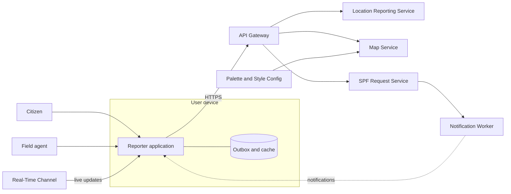
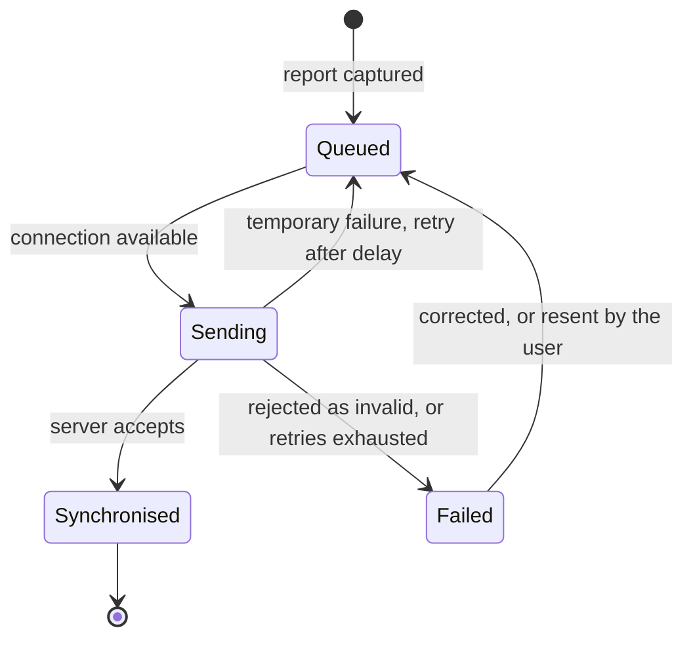

# Software Requirements Specification: Citizen and Field Agent Application (Mobile and Web)

| Item | Detail |
|------|--------|
| Project | Distributed Waste Management System (DWMS) |
| Component | Citizen / Field Agent Mobile + Web (`frontend/reporter`) |
| Course | CS 4122, Distributed Systems and Cloud Computing, ICT University |
| Document status | Draft 0.2, submitted for group review |
| Date | 16 November 2026 |
| Author | Egbe Michel Tambe |
| Objectives served | 1 (primary), 2 and 3 (as a client of the map and SPF services) |

---

## Table of Contents

1. Introduction
2. Overall Description
3. External Interfaces and Dependencies
4. Functional Requirements
5. Non-Functional Requirements
6. Constraints, Assumptions and Open Issues
7. Traceability
8. References

---

## 1. Introduction

### 1.1 Purpose

This document specifies the functional and non-functional requirements of the Citizen and Field Agent application of the Distributed Waste Management System (DWMS). It is written so that the other contributors working on the same component can review each requirement, comment on it and merge the individual proposals into one agreed specification. The structure follows the content recommended for a software requirements specification in ISO/IEC/IEEE 29148:2018 [1], and the quality attributes in Section 5 are organised according to the product quality model of ISO/IEC 25010:2023 [2].

### 1.2 Scope

The application is the client through which two groups of people interact with DWMS: citizens, who report waste and road problems and follow the outcome, and field agents, who report from the field, often with unreliable network coverage, and keep existing records up to date. It is delivered as a responsive web application that can be installed on a phone like a native application (see Section 6.2, assumption A1).

The application is responsible for:

- capturing waste-location reports and road-condition reports (Objective 1);
- displaying the colour-coded map of waste amount and road condition, using the palette defined in the main repository (Objective 2);
- letting an authorised user request the waste-collection service provider (SPF) for a given location and follow the request through its lifecycle (Objective 3).

The application is not responsible for storage of reports, spatial queries, tile or GeoJSON generation, authentication, dispatching, notification delivery, or the operator workflow. These belong to the services listed in Section 3 and are owned by other groups.

### 1.3 Definitions and abbreviations

| Term | Meaning |
|------|---------|
| Amount bucket | Coarse classification of the quantity of waste at a location (empty, low, moderate, high, overflow), as defined in the project README. |
| Citizen | A member of the public who reports or follows waste problems. |
| Field agent | A person authorised by a municipality or by the SPF to report and update records while in the field. |
| Outbox | A persistent local queue on the device that holds reports not yet accepted by the server. |
| SPF | Waste-collection service provider, as defined in the project README. |
| SPF request | A timestamped dispatch of the SPF to a waste location, with the lifecycle REQUESTED, ASSIGNED, IN_PROGRESS, COLLECTED, REJECTED or CANCELLED. |
| Jurisdiction | The municipality or district whose data a user is allowed to see (multi-tenant separation). |

### 1.4 Conventions

Requirements use the word "shall" for mandatory behaviour and "should" for desirable behaviour. Each requirement is intended to be singular, unambiguous and verifiable [1]. Identifiers have the form `FR-REP-nnn` for functional requirements and `NFR-REP-nnn` for non-functional requirements.

Priority follows the MoSCoW scheme: M (must), S (should), C (could). Every requirement has an acceptance criterion that states the observable condition under which it is considered met, followed by the verification method in brackets: [T] test, [I] inspection, [D] demonstration, [A] analysis.

Requirements state what the system must do or achieve and, where possible, not how. Where a design choice is unavoidable, it is stated as a constraint or recorded as an open issue to be settled in an architecture decision record (ADR). Numeric values marked "provisional" are starting points, and Section 5.8 gives the basis for each of them and how it is to be confirmed.

---

## 2. Overall Description

### 2.1 Product perspective

The application is one of three client types in the DWMS architecture (README, Architecture Overview). It communicates with the system only through the API Gateway over HTTPS and, for live updates, through the real-time channel. It never accesses a service database directly, in line with the rule stated in CONTRIBUTING.md that a service must not reach into another service's database.

### 2.2 User classes

| User class | Description | Typical context | Main needs |
|------------|-------------|-----------------|------------|
| Citizen | Registered member of the public. Possibly an anonymous visitor if the group decides to allow it (open issue O2). | Personal smartphone, intermittent mobile data, short sessions. | Report a problem quickly, see whether it was handled. |
| Field agent | Account created by an administrator. | Work phone or tablet outdoors, poor coverage, sunlight, one hand free. | Report and update reliably without signal, avoid duplicates, see what is already recorded nearby. |

Administrators and SPF operators use the Operations Dashboard and are outside the scope of this document.

### 2.3 Operating environment

The application runs in current mobile and desktop browsers. The operating context is relevant to several requirements. Connectivity in the target region is uneven: DataReportal estimated 12.4 million internet users in Cameroon at the start of 2025, a penetration of 41.9 percent, with mobile connections equal to about 86 percent of the population [3]. Many users therefore have a phone, but cannot be assumed to have a stable data connection or a generous data allowance. This motivates the offline-first and data-economy requirements in Sections 4.4 and 5.1.

### 2.4 Design rationale from distributed systems theory

The course material establishes that in a distributed system the network is unreliable, latency is not zero and bandwidth is not infinite, and that partial failure is the normal case rather than the exception [4], [5]. The client is the component most exposed to those conditions. Two consequences shape the requirements:

1. Under a network partition a system must choose between consistency and availability [6], [7]. Report capture is designed to remain available during a partition, so reports are accepted locally and reconciled later, which means that clients see the data under eventual consistency. Creation of an SPF request, which depends on the authoritative lifecycle state and on duplicate prevention, is designed to require connectivity (FR-REP-045).
2. Because retries are unavoidable on an unreliable network, every operation that creates data must be idempotent, otherwise retries produce duplicate waste locations (FR-REP-049, NFR-REP-009).

### 2.5 System context

The diagram shows the application, the data it keeps on the device, and the services it depends on. The services are those of the project README.

### 2.6 Usage scenarios

| No. | Scenario | Actor | Preconditions | Main flow | Alternative flows | Related requirements |
|-----|----------|-------|---------------|-----------|-------------------|----------------------|
| UC-01 | Report waste while online | Citizen | Logged in; device online. | 1. The user opens the report form. 2. The application fills in the current position and its accuracy. 3. The user chooses the amount bucket and waste type and adds a photograph. 4. The user submits. 5. The application shows a confirmation with identifier and status. | 2a. Location permission is denied or the accuracy is poor: the user places a pin on the map. 3a. A known active location lies nearby: the user adds an update to it or confirms that the report is new. 4a. Validation fails: the field is marked and nothing is sent. | FR-REP-010 to 014, 015, 018, 020, 021 |
| UC-02 | Report without network coverage | Field agent | Logged in earlier; device offline. | 1. The agent completes a report as in UC-01. 2. The application stores it in the outbox and shows it as queued. 3. Connectivity returns. 4. The application sends the queued reports in order of capture. 5. Each item changes to synchronised. | 4a. The server is unreachable: retries with increasing delay, then the item is marked failed and can be resent by hand. 4b. The server rejects an item as invalid: the item stays, the reason is shown, the agent corrects and resubmits. 4c. A response is lost: the repeated submission creates no duplicate. | FR-REP-040 to 044, 049; NFR-REP-009, 010 |
| UC-03 | Update an existing location | Field agent | Logged in; location visible on the map. | 1. The agent selects the location. 2. The agent changes the amount bucket and optionally adds a photograph. 3. The application records it as a new report on the location. | 3a. The location was changed by someone else since the agent last loaded it: both versions are shown and the agent chooses. | FR-REP-023, 046, 058 |
| UC-04 | Report a road condition | Citizen or field agent | Logged in. | 1. The user selects a road segment on the map. 2. The user chooses one of the four conditions and optionally adds a photograph and note. 3. The user submits. 4. The report is shown as unverified. | 1a. The segment is not on the map: the user reports the problem on the nearest waste location instead (see open issue O14). | FR-REP-030 to 033 |
| UC-05 | View and filter the map | Any user | Application open. | 1. The user opens the map. 2. The application shows waste locations and road segments with the palette and a legend. 3. The user applies filters, zooms and selects a location to see its details. | 2a. Offline: the last viewed region is shown with its refresh time. | FR-REP-050 to 059 |
| UC-06 | Request the SPF and follow the request | Authorised user | Logged in; device online. | 1. The user selects a location and requests the SPF. 2. The application shows the request as REQUESTED. 3. The status changes over time and each change appears without a page refresh. 4. The request ends as COLLECTED, REJECTED or CANCELLED. | 1a. An active request exists: it is displayed and no second request is created. 1b. Offline: the user is told that connectivity is required. | FR-REP-045, 070 to 074, 080 |
| UC-07 | Be informed of a status change | Requester | An SPF request exists; notifications enabled. | 1. The status of the request changes. 2. The user receives an in-application message and, if enabled, a push notification. | 1a. The application is closed: the push notification is shown by the device. | FR-REP-083 to 085 |
| UC-08 | Recover after losing the live connection | Any user | Map open; real-time channel connected. | 1. The connection is lost. 2. The application shows that live updates are suspended and continues by periodic polling. 3. The connection returns. 4. The application retrieves the changes it missed. | 2a. Polling is also unavailable: the last known data stay visible with their age. | FR-REP-081, 082; NFR-REP-012 |

---

## 3. External Interfaces and Dependencies

The application depends on the services below. Endpoint paths and payloads are not fixed here; they are to be defined by the owning group in the OpenAPI specifications under `docs/api/`. The right-hand column lists what this application needs from each service, so that the owning groups can confirm or contest it during review.

| Service (owning group) | Needs of the application |
|------------------------|--------------------------|
| API Gateway: authentication, rate limiting | Registration and login, short-lived access tokens, token refresh, role and jurisdiction claims, CORS for the application origin, rate-limit responses with a `Retry-After` header. |
| Location Reporting Service | Accept waste reports and road-condition reports carrying a client-generated identifier; return the reports of the authenticated user; return the waste-type list; accept updates with a version indicator for conflict detection. |
| Geo Store (PostGIS) | Used indirectly. No direct access. |
| Map Service | Viewport-scoped GeoJSON for waste locations and road segments, including the fields needed by the palette (amount bucket, road condition, last report time). |
| Palette and Style Config | Versioned palette (`palette.json`) available to the client, so that no colour value is defined in the client itself. |
| SPF Request Service | Create a request for a waste location, read a request and its status history, cancel a request. |
| Real-Time Channel | Subscription by viewport or jurisdiction, event identifiers that allow a client to resume after a disconnection. |
| Notification Worker | Registration of a push subscription, delivery of status changes, notification preferences. |
| IoT Smart Bins | Indirect. Locations whose data originate from sensors are displayed with their source indicated. |
| Operations Dashboard | None directly. The two applications share the map semantics (palette, legend, filters) and should share the same component library where practicable. |

Data exchange formats: JSON for API payloads; GeoJSON for geometry, in which coordinates are ordered longitude, latitude as required by RFC 7946 [8]; timestamps in UTC in the RFC 3339 format; error responses in the problem-details format of RFC 9457 [9].

---

## 4. Functional Requirements

### 4.1 Account and access

| ID | Requirement | Obj | Pri | Acceptance criterion |
|----|-------------|-----|-----|----------------------|
| FR-REP-001 | The application shall allow a visitor to register as a citizen by providing an email address and a password. | 1 | M | A new email and password create an account that can then log in; a duplicate or malformed email is refused with a message. [T] |
| FR-REP-002 | The application shall allow a registered user to log in with the credentials used at registration and shall obtain an access token from the API Gateway. | 1, 3 | M | Valid credentials give an authenticated session; invalid credentials do not, and the message does not reveal which field was wrong. [T] |
| FR-REP-003 | The application shall not provide self-registration for the field agent role; field agent accounts shall be created by an administrator. | 1 | M | The application contains no sign-up path for the field agent role. [I] |
| FR-REP-004 | The application shall keep the user logged in across browser restarts until the refresh token expires or the user logs out. | 1 | M | Closing and reopening the browser within the refresh lifetime keeps the session; after expiry the login screen appears. [T] |
| FR-REP-005 | The application shall show or hide functions according to the role claim in the access token (citizen or field agent). The server remains the authority for every authorisation decision. | 1, 3 | M | A citizen session shows no field-agent-only controls, and a field-agent function called with a citizen token is refused by the server. [T] |
| FR-REP-006 | On logout, the application shall remove the tokens and cached personal data from the device and shall warn the user beforehand if the outbox contains reports that have not been synchronised. | 1 | S | After logout no token or cached personal data remain on the device; a warning appears when the outbox is not empty. [T] |
| FR-REP-007 | The application shall display only data belonging to the jurisdiction of the authenticated user, as returned by the server. | 3 | M | With seeded data for two jurisdictions, a user of one never sees records of the other. [T] |

### 4.2 Waste-location reporting (Objective 1)

| ID | Requirement | Obj | Pri | Acceptance criterion |
|----|-------------|-----|-----|----------------------|
| FR-REP-010 | The application shall obtain the position of the device from its location services when the user requests it, and shall record the reported accuracy radius with the position. | 1 | M | With permission granted, the form receives a position and an accuracy value; with permission denied or no fix, a message and the pin option are shown. [T] |
| FR-REP-011 | The application shall display the accuracy radius to the user and shall warn the user when the radius exceeds a configurable threshold (provisional: 50 m). | 1 | S | A simulated fix above the threshold shows a warning; one below it does not. [T] |
| FR-REP-012 | The application shall allow the user to set or adjust the report position by placing a pin on the map, without requiring a position from the device. | 1 | M | With location permission denied, the user places a pin and the submitted coordinates equal the pin position. [D] |
| FR-REP-013 | The application shall require the user to choose one amount bucket from empty, low, moderate, high or overflow. The "unknown or stale" state of the palette is derived by the system and shall not be selectable. | 1, 2 | M | The form cannot be submitted without a bucket; exactly the five buckets are offered. [T] |
| FR-REP-014 | The application shall require the user to choose one waste type from a controlled list obtained from the Location Reporting Service. | 1 | M | The form cannot be submitted without a type; the options equal the list returned by the service. [T] |
| FR-REP-015 | The application shall allow the user to attach at least one photograph to a report, taken with the device camera or chosen from the device storage. | 1 | M | A photograph taken or chosen is previewed and included in the submission. [D] |
| FR-REP-016 | The application shall allow the user to enter an optional free-text note of at most 500 characters. | 1 | C | A note of 500 characters is accepted and one of 501 is refused. [T] |
| FR-REP-017 | The application shall record the time of capture from the device clock and shall send it as a separate field from the time of receipt, which is assigned by the server. | 1 | M | A report created offline carries a capture time earlier than its receipt time, and both are stored. [I] |
| FR-REP-018 | The application shall validate the report before submission: required fields present, latitude between -90 and 90, longitude between -180 and 180, note length within the limit, photograph type and size within the limit. | 1 | M | Each invalid case (missing field, latitude 91, longitude -181, long note, wrong or oversized photograph) is blocked with a message naming the field. [T] |
| FR-REP-019 | The application shall allow the reporter to mark a location as hazardous (for example medical or chemical waste) and shall then display a notice advising the reporter not to handle the waste. | 1 | C | Setting the flag shows the notice and sets the flag in the submission. [D] |
| FR-REP-020 | The application shall, before submission, display existing active waste locations within a configurable radius (provisional: 25 m) and shall let the user either add an update to one of them or confirm that the report concerns a new location. | 1 | S | A report made within the radius of an existing active location shows that location and offers both choices. [D] |
| FR-REP-021 | The application shall display a confirmation containing the report identifier and its initial status after the server accepts a report. | 1 | M | The confirmation appears after server acceptance and not before. [T] |
| FR-REP-022 | The application shall list the reports submitted by the current user with their current status. | 1 | M | The list shows the reports of the user with their status and none of other users. [T] |
| FR-REP-023 | The application shall allow a field agent to update the amount bucket of an existing waste location they are authorised to modify, and shall record the update as a new report on that location rather than overwriting history. | 1, 2 | M | An update adds an entry to the location history and the earlier entries remain. [T] |
| FR-REP-024 | The application should allow a reporter to withdraw or correct their own report while it has not yet been reviewed by an operator. | 1 | C | An unreviewed report can be withdrawn; a reviewed one cannot. [T] |

### 4.3 Road-condition reporting (Objective 1 and 2)

| ID | Requirement | Obj | Pri | Acceptance criterion |
|----|-------------|-----|-----|----------------------|
| FR-REP-030 | The application shall allow the user to report the condition of a road segment as good or paved, degraded, unpaved, or impassable, the four values of the road-condition dimension of the palette. | 1, 2 | M | Exactly the four values are offered and the chosen value is submitted. [T] |
| FR-REP-031 | The application shall allow the user to identify the affected road segment by selecting it on the map layer supplied by the Map Service. | 1, 2 | M | Selecting a segment highlights it and the submitted report carries its identifier. [D] |
| FR-REP-032 | The application should allow the user to attach a photograph and a note to a road-condition report. | 1 | S | A photograph and note submitted with a road report appear in its detail. [D] |
| FR-REP-033 | The application shall display each road-condition report with its reporter category, time of report and verification status, and shall show the status as unverified until the server marks it verified. | 1 | S | A new report shows "unverified" and shows "verified" after the server changes it. [T] |
| FR-REP-034 | The application could allow the user to link a road-condition report to the waste location the road serves. | 1, 2 | C | A report saved with a selected waste location shows the link in both detail views. [D] |

### 4.4 Offline operation and synchronisation

An item in the outbox passes through the states shown below. The states are those named in FR-REP-041.

| ID | Requirement | Obj | Pri | Acceptance criterion |
|----|-------------|-----|-----|----------------------|
| FR-REP-040 | The application shall store a report, together with its photographs, persistently on the device when the device has no connectivity or when the server cannot be reached. | 1 | M | With the network disabled, a submitted report and its photograph remain after the page is reloaded. [T] |
| FR-REP-041 | The application shall display the connectivity state and, for every item awaiting transmission, one of the states queued, sending, synchronised or failed. | 1 | M | The indicator changes when the network is switched off and on, and each item shows one of the four states. [D] |
| FR-REP-042 | The application shall resend queued items automatically when connectivity returns, in the order of capture. | 1 | M | Three reports captured offline in the order A, B, C reach the server in that order after reconnection. [T] |
| FR-REP-043 | The application shall space retries with increasing delay and random variation, and shall stop automatic retries after a configurable number of attempts (provisional: 5), after which the item is marked failed and can be resent manually. | 1 | M | With the server returning errors, the delays grow and vary, attempts stop at the limit, and the item shows as failed with a manual resend. [T] |
| FR-REP-044 | When the server rejects an item permanently because of a validation error, the application shall keep the item, show the reason in plain language, and allow the user to correct and resubmit it. | 1 | M | A rejected item stays in the queue with the reason shown and a corrected resubmission is accepted. [T] |
| FR-REP-045 | The application shall require connectivity to create or cancel an SPF request and shall tell the user so, instead of queuing the request locally. | 3 | S | While offline, the request action is refused with an explanation and nothing is queued. [D] |
| FR-REP-046 | When a queued update refers to a location that has been changed on the server after the update was captured, the application shall show both versions and ask the user which to keep. | 1 | S | An update captured against an outdated version shows both versions and applies the one chosen. [D] |
| FR-REP-047 | The application shall keep the most recently viewed map region and the legend and shall display them when offline, labelled with the time the data were last refreshed. | 1, 2 | S | While offline, the last viewed region and the legend are shown with the refresh time. [D] |
| FR-REP-048 | The application shall send queued items when it is opened with a connection and when connectivity returns while it is open, and shall not depend on any browser capability that is missing from a supported browser. | 1 | M | Queued items are sent in each browser of the supported set, including one without background synchronisation support. [T] |
| FR-REP-049 | The application shall assign every report a client-generated universally unique identifier at the moment of capture and shall send it with every attempt to submit that report, so that repeated attempts do not create duplicate records. | 1 | M | A submission repeated with the same identifier results in one record on the server. [T] |

### 4.5 Map and visualisation (Objective 2)

| ID | Requirement | Obj | Pri | Acceptance criterion |
|----|-------------|-----|-----|----------------------|
| FR-REP-050 | The application shall display an interactive map that loads waste locations and road segments for the visible viewport from the Map Service. | 2 | M | Panning to a new area sends a request bounded by the new viewport and the features of that area appear. [D] |
| FR-REP-051 | The application shall draw each waste location with a fill colour for its amount bucket, and shall draw each road segment with the line style and colour of its road condition, using the values of the current published palette. | 2 | M | Each of the five buckets and four conditions is drawn with the colour and style given in the palette. [I] |
| FR-REP-052 | The application shall take the colour values for these encodings from the published palette, which is the single source of truth, and shall not define its own. | 2 | M | No colour literal for these encodings appears in component code, and a new palette version changes the display without a code change. [I] |
| FR-REP-053 | The application shall display a legend for both dimensions on every map view without requiring hovering or selection. | 2 | M | The legend shows both dimensions on every map view without interaction. [I] |
| FR-REP-054 | The application shall additionally distinguish amount buckets by marker size and shape glyph, and road conditions by line pattern, so that the map remains readable without colour. | 2 | M | In a greyscale screenshot a viewer can tell the five buckets and four conditions apart. [T] |
| FR-REP-055 | The application shall draw a waste location as unknown or stale, in grey with reduced opacity, when its last report is older than the staleness threshold (7 days in the README, configurable). | 2 | M | A location whose last report is older than the threshold is drawn grey with reduced opacity; a more recent one is not. [T] |
| FR-REP-056 | The application shall cluster waste locations at low zoom levels and separate them as the user zooms in, without a full reload of the data. | 2 | S | Zooming out clusters nearby locations and zooming in separates them without a new request for the same viewport. [D] |
| FR-REP-057 | The application shall provide filters on amount bucket, road condition, waste type, freshness and SPF request status. | 2 | S | Each filter reduces the display to the matching locations and the legend remains visible. [D] |
| FR-REP-058 | The application shall display, for a selected waste location, its attributes, photographs, report history and current SPF request status. | 2, 3 | M | Selecting a location shows the four kinds of information. [D] |
| FR-REP-059 | The application shall provide a control that centres the map on the current position of the user. | 2 | M | Using the control centres the map on the position reported by the device. [D] |
| FR-REP-060 | The application shall display the attribution required by the basemap licence on every map view. | 2 | M | The attribution text is visible on every map view. [I] |

### 4.6 SPF requests (Objective 3)

| ID | Requirement | Obj | Pri | Acceptance criterion |
|----|-------------|-----|-----|----------------------|
| FR-REP-070 | The application shall allow an authorised user to request the SPF for a selected waste location, with an optional reason. The roles authorised to do so are an open issue (O3). | 3 | M | An authorised user submits a request that appears with status REQUESTED; an unauthorised user cannot. [T] |
| FR-REP-071 | The application shall prevent the creation of a second active SPF request for a location that already has one, and shall display the existing request instead. | 3 | M | A second attempt shows the existing request and no second request is created. [T] |
| FR-REP-072 | The application shall display the status of an SPF request as one of REQUESTED, ASSIGNED, IN_PROGRESS, COLLECTED, REJECTED or CANCELLED, with the time of each status change. | 3 | M | A request taken through the lifecycle shows each status with its time. [T] |
| FR-REP-073 | The application shall allow the requester to cancel an SPF request while its status is REQUESTED. | 3 | S | Cancellation works while REQUESTED and is not offered in any other status. [T] |
| FR-REP-074 | The application shall list the SPF requests made by the current user. | 3 | M | The list shows the requests of the user and none of other users. [T] |

### 4.7 Real-time updates and notifications (Objective 3)

| ID | Requirement | Obj | Pri | Acceptance criterion |
|----|-------------|-----|-----|----------------------|
| FR-REP-080 | The application shall update the map and the SPF request views from events received on the real-time channel, without the user refreshing the page. | 3 | M | A status change made from another client appears without a page reload. [D] |
| FR-REP-081 | When the real-time channel is unavailable, the application should fall back to periodic polling at a configurable interval and shall indicate that live updates are suspended. | 3 | S | With the real-time service stopped, a notice appears and changes still arrive by polling. [T] |
| FR-REP-082 | After a disconnection, the application shall reconnect with increasing delay and shall retrieve the changes missed since the last event it processed. | 3 | M | Changes made during a disconnection appear after the application reconnects. [T] |
| FR-REP-083 | The application shall inform the user inside the application when the status of one of their SPF requests changes. | 3 | M | A status change of the request of the user produces a message in the application. [D] |
| FR-REP-084 | The application should allow the user to enable push notifications for status changes of their requests and shall request the device permission only after an explicit user action. | 3 | S | After opting in, a status change produces a notification; the permission prompt appears only after the user presses the opt-in control. [D] |
| FR-REP-085 | The application could allow the user to choose which events generate notifications. | 3 | C | Disabling an event type stops its notifications. [D] |

### 4.8 Navigation, language and profile

| ID | Requirement | Obj | Pri | Acceptance criterion |
|----|-------------|-----|-----|----------------------|
| FR-REP-090 | The application could allow a field agent to request a route from the current position to a selected waste location and display its geometry, distance and estimated travel time. This depends on the routing decision described in open issue O6. | 3 | C | A reachable destination shows a route, its distance and time; an unreachable one shows an error message. [D] |
| FR-REP-091 | The application shall be available in English and French and shall allow the user to change the language at any time. | 1, 2, 3 | S | Switching language changes all interface text, and a scan finds no untranslated string. [T] |
| FR-REP-092 | The application shall display the profile of the user: name, role and jurisdiction. | 1 | S | The displayed name, role and jurisdiction match the account. [I] |

---

## 5. Non-Functional Requirements

The requirements are grouped by the characteristics of ISO/IEC 25010:2023 [2]. The basis of each provisional value is given in Section 5.8.

### 5.1 Performance efficiency

| ID | Requirement | Pri | Acceptance criterion |
|----|-------------|-----|----------------------|
| NFR-REP-001 | The application shall respond to a local interaction (opening a form, selecting a marker, toggling a filter) with visible feedback in 100 ms or less. | M | Measured delay between input and feedback is at most 100 ms for these interactions on the reference device. [T] |
| NFR-REP-002 | The application shall become usable on a first visit in 5 s or less on a throttled network equivalent to the "Fast 3G" profile of the Chrome developer tools and a mid-range mobile device profile (provisional). | M | In at least 9 of 10 runs the application is usable within 5 s under that profile. [T] |
| NFR-REP-003 | The data transferred for a first visit with an empty cache, excluding map data and photographs, shall not exceed 1 MB (provisional). | S | The network log of a cold first visit shows at most 1 MB transferred. [T] |
| NFR-REP-004 | After a pan or zoom, the application shall display the data for the new viewport in 2 s or less at the 95th percentile for at most 500 features, under the profile of NFR-REP-002 (provisional). | S | Over 20 runs the 95th percentile is at most 2 s. [T] |
| NFR-REP-005 | The application shall reduce each photograph on the device before upload to at most 500 KB (provisional), to limit the cost of data to the user and the load on the network. | S | A photograph larger than the limit is reduced before upload, as shown by the network log. [T] |
| NFR-REP-006 | A change received on the real-time channel shall appear in the user interface in 1 s or less after receipt. The end-to-end propagation target of the platform ("within seconds" in the README) is to be quantified jointly with the Real-Time Channel group (open issue O8). | S | Measured with a timestamped test event, the interface updates within 1 s of receipt. [T] |
| NFR-REP-007 | The application shall not track the device position while it is in the background or while the report screen is closed, so as to limit battery and data use. | S | Position tracking is inactive when the report screen is closed or the application is in the background. [I] |

### 5.2 Reliability, availability and consistency

| ID | Requirement | Pri | Acceptance criterion |
|----|-------------|-----|----------------------|
| NFR-REP-008 | The creation and queuing of reports shall remain fully available when the backend is unreachable. The static application shall be served with a monthly availability target of 99.9 percent (about 43.8 minutes of downtime per month) and the platform API with a target of 99.5 percent (about 3.65 hours per month), to be confirmed with the Gateway group. | M | The offline test of FR-REP-040 passes, and monitored availability over a calendar month meets the two targets. Calculation as in the course [5]. [T, A] |
| NFR-REP-009 | A report that is submitted more than once, for example after a retry, shall result in a single record. The mechanism (client identifier, server de-duplication, request header) is to be decided with the Location Reporting Service group in an ADR (open issue O11). | M | Twenty repeated submissions of one report after simulated loss of the response produce one record. [T] |
| NFR-REP-010 | A report accepted into the outbox shall survive closing the application, restarting the browser and loss of power, and shall be removed from the outbox only after the server confirms it. | M | After the browser is forcibly closed and the device restarted, the item is still present and is sent; it disappears only after confirmation. [T] |
| NFR-REP-011 | Every network call shall end within a time limit (provisional: 10 s for data, 60 s for photograph upload). The client shall retry automatically only operations that are safe to repeat, and only a bounded number of times. | M | A stalled server ends the call at the limit and the user is informed; an operation that is not safe to repeat is not retried automatically. [T] |
| NFR-REP-012 | The failure of one dependency shall not disable unrelated functions: loss of the Map Service shall not prevent report submission; loss of the real-time channel shall not prevent viewing; loss of the notification service shall not prevent SPF requests. | M | With each of the three services stopped in turn, the unrelated functions listed still work. [T] |
| NFR-REP-013 | The application shall never display a queued item as confirmed. Items awaiting synchronisation shall be visibly distinguished from items accepted by the server. | M | A review of screenshots shows queued and accepted items looking different in every list and detail view. [I] |
| NFR-REP-014 | The application shall not rely on the device clock for ordering on the server. The device time shall be stored as informational and the server receipt time shall be used for ordering, because device clocks drift and can be set by the user. | M | A report made with the device clock set one day ahead is ordered by its receipt time. [T] |
| NFR-REP-015 | The application shall display an understandable message and a retry option for every failure of a network operation, and shall never lose user input as a result of such a failure. | M | Each injected failure produces a message and a retry option, and the entered form data are retained. [T] |

### 5.3 Security and privacy

| ID | Requirement | Pri | Acceptance criterion |
|----|-------------|-----|----------------------|
| NFR-REP-020 | All communication between the application and the platform shall be protected with TLS 1.2 or later. The application shall be served over HTTPS only, which is also required for access to device location and for offline operation. | M | Plain HTTP requests are refused or redirected, and a TLS scan of the deployment reports version 1.2 or later only. [T] |
| NFR-REP-021 | The application shall not store passwords. Authentication tokens shall not be kept in general-purpose browser storage and shall, where the platform allows it, be kept out of reach of scripts running in the page. The mechanism is to be agreed with the Gateway group (open issue O12). | M | No password or token is found in browser storage, and a script injected in a test cannot read the token where the platform allows protection. [I, T] |
| NFR-REP-022 | The application shall resist cross-site scripting: text supplied by users (notes, names) shall never be interpreted as markup or script when displayed. | M | Test strings containing script code are displayed as plain text and an automated security scan reports no cross-site scripting. [T] |
| NFR-REP-023 | The application shall remove location and device metadata embedded in photographs before upload, because such metadata can identify the device and give a position other than the one entered in the report. | M | A geotagged photograph uploaded through the application contains no location or device metadata when retrieved. [T] |
| NFR-REP-024 | The application shall validate input on the client for usability, but no decision about authorisation or data validity shall rest on the client alone. | M | Inspection shows no authorisation decision made only in the client, and a request with an invalid payload sent directly to the API is refused (joint test with the Location Reporting Service group). [I, T] |
| NFR-REP-025 | The application shall handle the response 429 by waiting for the time given in `Retry-After` and shall inform the user. | S | After a 429 with `Retry-After`, no request is sent before the stated time and a message is shown. [T] |
| NFR-REP-026 | The outbox and caches shall contain only the data necessary for the function and shall be deleted on logout (data minimisation). No credentials shall be stored in the outbox. | M | After logout the outbox and caches are empty, and the outbox never contained credentials. [T] |
| NFR-REP-027 | The client bundle shall contain no secrets or API keys. Configuration shall be provided at build or run time through environment variables, with only a `.env.example` committed, as required by CONTRIBUTING.md. | M | A search of the built files for key patterns finds none, and only `.env.example` is present in the repository. [I] |
| NFR-REP-028 | Third-party dependencies shall be pinned through the lock file and checked for known vulnerabilities in continuous integration. High-severity findings shall block a merge. | S | The check runs in continuous integration and a high-severity finding fails the build. [T] |
| NFR-REP-029 | The design shall be reviewed against the categories STORAGE, NETWORK and AUTH of the OWASP Mobile Application Security Verification Standard [12] and the result recorded in `docs/`. | S | A review document addressing the three categories exists in `docs/`. [A] |
| NFR-REP-030 | The identity of a reporter shall not be shown to other citizens. Only users with an operator or administrator role may see it. Personal data shall be handled in accordance with Law No. 2024/017 of 23 December 2024 on personal data protection in Cameroon [13], including a statement of purpose and consent at registration. The legal interpretation requires confirmation by the group or the lecturer (open issue O9). | M | No view available to a citizen shows another citizen's identity, and registration displays the purpose and asks for consent. [I] |

### 5.4 Usability and accessibility

| ID | Requirement | Pri | Acceptance criterion |
|----|-------------|-----|----------------------|
| NFR-REP-040 | The web application shall conform to WCAG 2.2 level AA [14], including the minimum target size of 24 by 24 CSS pixels for pointer targets (success criterion 2.5.8). Primary actions should be at least 44 by 44 CSS pixels, to suit use outdoors with one hand. | M | An automated accessibility check and a manual review of the core screens find no level AA failure, and measured target sizes meet the minimum. [T] |
| NFR-REP-041 | Colour shall never be the only means of conveying amount or road condition (consistent with FR-REP-054 and the README rule on redundant encoding). The map shall be checked in greyscale and with a simulation of colour-vision deficiency before each release. | M | A record of the greyscale and colour-vision-deficiency check exists for each release. [T] |
| NFR-REP-042 | In a usability test with at least five representative users, the median time to complete a waste report with a photograph, from opening the application, shall not exceed 60 s (provisional). | S | The median over five or more participants is at most 60 s. [T] |
| NFR-REP-043 | The interface shall remain readable in bright light: text contrast ratio of at least 4.5:1 for normal text and 3:1 for large text and graphical objects. | M | Measured contrast ratios of the core screens meet these values. [T] |
| NFR-REP-044 | Error messages shall state what happened and what the user can do, in the language selected. Server errors in the RFC 9457 format [9] shall be mapped to such messages. | M | Each error scenario in the test list displays a message with its cause and next step in the selected language. [I] |
| NFR-REP-045 | The application shall be usable with a screen reader for all functions except the map canvas itself, for which an equivalent list view of the visible locations shall be provided. | S | A screen-reader user completes a report and reads the list of visible locations. [T] |
| NFR-REP-046 | The user interface text shall be held in translation files, so that no text is hard-coded in components. | M | No user-visible text literal remains in component code. [I] |

### 5.5 Compatibility, portability and interoperability

| ID | Requirement | Pri | Acceptance criterion |
|----|-------------|-----|----------------------|
| NFR-REP-050 | The application shall work in the two most recent major versions of Chrome, Firefox, Safari and Edge, and on Chrome for Android, from a viewport width of 320 CSS pixels upwards. | M | The core flows pass in each browser of the set at a width of 320 CSS pixels. [T] |
| NFR-REP-051 | The application shall be installable on the home screen of a phone and shall then open full-screen like a native application. | S | The browser offers installation and the installed application opens full-screen. [D] |
| NFR-REP-052 | Functions that depend on features of limited browser support (background synchronisation, push notifications on some platforms) shall be enhancements. The core functions shall work without them. Background synchronisation is not supported in Firefox or Safari [15]. | M | The core flows pass in Firefox and Safari with the optional features unavailable. [T] |
| NFR-REP-053 | The application shall use the API contracts published in `docs/api/`. Any incompatibility discovered during development shall be raised as an issue on the owning service and not worked around silently. | M | A contract test of the application's requests against the OpenAPI specifications passes, and each mismatch found has an issue. [T] |
| NFR-REP-054 | Timestamps shall be exchanged in UTC (RFC 3339) and geometry in GeoJSON with longitude first, latitude second [8]. | M | Sample payloads sent by the application validate against these formats. [T] |
| NFR-REP-055 | The basemap source shall comply with its usage policy. The public OpenStreetMap tile servers must not be used for distributed or heavy use, and tiles must not be bulk-downloaded for offline use [16]. A local or hosted tile server in `infrastructure/`, or a provider that permits the use, shall be chosen and recorded in an ADR. | M | The configured tile source is not the public OpenStreetMap server, or written permission is recorded, and an ADR exists. [I] |

### 5.6 Maintainability and observability

| ID | Requirement | Pri | Acceptance criterion |
|----|-------------|-----|----------------------|
| NFR-REP-060 | The code shall be written in TypeScript with the compiler in strict mode and shall pass ESLint, Prettier and `tsc --noEmit` without errors in continuous integration, as required by CONTRIBUTING.md. | M | The continuous integration run of the three tools reports no error. [T] |
| NFR-REP-061 | Unit tests (Vitest) shall cover the validation, outbox, retry and conflict logic with line coverage of those modules at or above a threshold set by the group (provisional: 70 percent). | S | The coverage report for those modules meets the threshold. [T] |
| NFR-REP-062 | End-to-end tests (Playwright) shall cover at least three flows: offline report followed by synchronisation, map display with legend, and SPF request with status update. | S | The three end-to-end flows run successfully in continuous integration. [T] |
| NFR-REP-063 | Every request sent by the application shall carry an identifier that allows it to be traced across services, and client errors shall be logged without personal data. | S | A request identifier sent by the application appears in the logs of the Gateway, and sampled client logs contain no personal data. [I, T] |
| NFR-REP-064 | Every architectural decision that deviates from the README or CONTRIBUTING.md (library, storage mechanism, tile source) shall be recorded in an ADR under `docs/architecture/adr/`. | M | Each deviation found in review has a matching ADR. [I] |
| NFR-REP-065 | The application shall provide a `Dockerfile` and a Compose service block with pinned image tags, so that `docker compose up` starts it from a clean clone. | M | `docker compose up` from a clean clone starts the application. [T] |

### 5.7 Safety

| ID | Requirement | Pri | Acceptance criterion |
|----|-------------|-----|----------------------|
| NFR-REP-070 | The application shall not instruct or encourage users to approach or handle waste or flooded or blocked roads. Where a location is marked hazardous or a road impassable, a visible caution shall be shown. | S | The caution appears for a hazardous location and for an impassable road. [I] |

### 5.8 Provisional values and their basis

The values below were not measured on the target devices and networks. The table states where each comes from, so that a reviewer can accept it, change it, or ask for a measurement. Values marked "judgement" have no external source and are the author's estimate.

| Value | Used in | Basis | How to confirm |
|-------|---------|-------|----------------|
| 100 ms feedback | NFR-REP-001 | About 0.1 s is the limit within which a response is perceived as immediate [10]. | Measure on the reference device. |
| 24 and 44 CSS pixel targets | NFR-REP-040 | WCAG 2.2 success criterion 2.5.8 sets 24 pixels at level AA, and the level AAA criterion 2.5.5 sets 44 pixels [14]. | Measure on core screens. |
| 4.5:1 and 3:1 contrast | NFR-REP-043 | WCAG 2.2 success criteria 1.4.3 and 1.4.11 [14]. | Contrast checker on core screens. |
| 99.9 percent static availability | NFR-REP-008 | Corresponds to 8.76 hours of downtime per year in the course table [5]. | Uptime monitoring. |
| 99.5 percent API availability | NFR-REP-008 | Judgement: a lower tier than the static shell, suited to a student cloud deployment. To be agreed with the Gateway group. | Uptime monitoring. |
| 50 m accuracy warning | FR-REP-011 | GPS.gov reports that GPS-enabled smartphones are typically accurate to within a 4.9 m radius under open sky and that accuracy worsens near buildings, bridges and trees [17]. The threshold is about ten times that figure and marks the point where a manual pin is likely to be better. Judgement for the factor. | Compare reported accuracy values in a field test. |
| 25 m duplicate radius | FR-REP-020 | Judgement: larger than the typical error in [17] and smaller than a typical street block. | Test with seeded locations. |
| 5 s first-use load | NFR-REP-002 | Google rates a largest contentful paint of 2.5 s or less as good, assessed at the 75th percentile [18]. The 5 s value relaxes this for the throttled network profile. Judgement for the factor of two. | Run the throttled test on the reference device. |
| 1 MB first-visit transfer | NFR-REP-003 | Judgement, from the data-cost concern in Section 2.3. | Network log of a cold visit. |
| 2 s viewport refresh, 500 features | NFR-REP-004 | Judgement. | Repeat the test 20 times. |
| 500 KB photograph | NFR-REP-005 | Judgement: phone photographs are commonly several megabytes, so a limit well below that reduces data cost. | Compare quality of reduced photographs. |
| 10 s and 60 s time limits, 5 retries | NFR-REP-011, FR-REP-043 | Judgement. | Adjust after field tests on a slow network. |
| 500-character note | FR-REP-016 | Judgement. | Review with the Location Reporting Service group. |
| 60 s report time, five users | NFR-REP-042 | Judgement. | Usability test. |
| 70 percent coverage | NFR-REP-061 | Judgement; to be replaced by a group-wide figure. | Coverage report. |
| 7 days staleness | FR-REP-055 | Taken from the README palette specification. | Not applicable. |

---

## 6. Constraints, Assumptions and Open Issues

### 6.1 Constraints

C1. CONTRIBUTING.md lists React 18, TypeScript, Vite, TanStack Query and react-hook-form for `frontend/reporter`. A change requires an ADR. Map display in the reporter application uses MapLibre GL JS, which the README names as the frontend mapping library and CONTRIBUTING.md lists for the dashboard; its use in the reporter application is assumed (A5, open issue O13).
C2. The palette is the specification in the README and `services/map/style/palette.json`. The application consumes it and does not redefine it.
C3. The component must be able to run without a commercial API key.
C4. The 100-task development plan of the course names Leaflet and OSRM as examples of a map library and routing engine. The repository specifies MapLibre. The repository is taken as authoritative and the difference is recorded in open issue O6.

### 6.2 Assumptions

A1. A single responsive web application that can be installed on a phone is acceptable as "Mobile + Web". Native mobile applications are out of scope. If the lecturer requires a native application, the offline requirements remain valid but the storage and notification requirements change.
A2. The Gateway issues tokens that carry the role and the jurisdiction of the user.
A3. The Location Reporting Service accepts a client-generated identifier and treats repeated submissions of the same identifier as one report.
A4. Road segments exist as map data served by the Map Service. The reporter application does not create road geometry.
A5. The reporter application uses MapLibre GL JS for the map, as the README specifies for the frontend.

### 6.3 Open issues for group discussion

| No. | Question | Why it matters | Related requirements |
|-----|----------|----------------|----------------------|
| O1 | Is a single installable web application acceptable, or is a native mobile application expected? | Determines storage, push and installation requirements. | A1, FR-REP-084, NFR-REP-051 |
| O2 | May citizens submit reports without an account? | Anonymous input increases abuse risk and conflicts with a "reporter identity" attribute, but lowers the barrier to participation. | FR-REP-001, NFR-REP-030 |
| O3 | Which roles may request the SPF? The README scenarios show an operator doing so, while Objective 3 speaks of clients. | Defines the scope of the SPF functions in this application. | FR-REP-070 |
| O4 | Who may cancel a request after it is ASSIGNED, and may a field agent confirm collection on site? | Completes the lifecycle rules. | FR-REP-072, FR-REP-073 |
| O5 | Is the amount bucket derived from a percentage the reporter estimates, or chosen directly as a label? | The README gives percentage ranges, which the user interface would have to explain. | FR-REP-013 |
| O6 | Does the platform include route calculation for field agents? The 100-task plan (Phase 9) assumes it, the README does not mention it. | Decides whether FR-REP-090 is in scope. | FR-REP-090, C4 |
| O7 | What is the waste-type taxonomy and who maintains it? | The reporter form needs a fixed list. | FR-REP-014 |
| O8 | What is the quantified end-to-end propagation target for real-time updates? | The README states "within seconds". | NFR-REP-006 |
| O9 | What are the obligations of the project under Law 2024/017 for a student system that handles real citizen data? | Affects consent, retention and the use of real data in testing. CONTRIBUTING.md already forbids committing real citizen data. | NFR-REP-026, NFR-REP-030 |
| O10 | Which service stores photographs, and with what size and retention limits? | The README mentions photo evidence but no storage service. | FR-REP-015, NFR-REP-005 |
| O11 | Which mechanism guarantees that a repeated submission creates one record? A request header of the kind described in an IETF Internet-Draft [11], a client identifier in the payload, or another? | Must be the same on the client and in the Location Reporting Service. Needs an ADR. | FR-REP-049, NFR-REP-009 |
| O12 | How are authentication tokens carried between the browser and the Gateway? | Determines how the client can protect them. | NFR-REP-021 |
| O13 | Is MapLibre GL JS confirmed for the reporter application, given that CONTRIBUTING.md lists it only for the dashboard? | Affects bundle size and the shared component library. | C1, A5 |
| O14 | What does a user do when the road segment they want to report is missing from the map data? | Road reporting depends on the completeness of the segment layer. | FR-REP-031, UC-04 |

---

## 7. Traceability

### 7.1 Requirements by project objective

| Objective | Requirement groups |
|-----------|--------------------|
| 1. Collect waste-location information | Sections 4.1, 4.2, 4.3, 4.4 |
| 2. Colour-coded map of waste amount and road condition | Section 4.5, FR-REP-013, FR-REP-030, FR-REP-031 |
| 3. Cloud service to view, update and request the SPF in real time | Sections 4.6, 4.7, FR-REP-007 |

### 7.2 Relation to the course development plan

| Phase of the 100-task plan | Related requirements |
|----------------------------|----------------------|
| 1. Requirements analysis (tasks 1 to 10) | This document; sections 2, 4 and 5 |
| 5. Backend API (tasks 41 to 50) | Section 3 (interfaces); FR-REP-001, FR-REP-002 |
| 6. Interactive map (tasks 51 to 60) | Section 4.5 |
| 7. Waste reporting and road conditions (tasks 61 to 70) | Sections 4.2 and 4.3 |
| 8. Cloud and distributed communication (tasks 71 to 80) | Sections 4.4, 4.7; NFR-REP-008 to NFR-REP-015 |
| 9. Routing (tasks 81 to 90) | FR-REP-090 (open issue O6) |
| 10. Security, testing, documentation (tasks 91 to 100) | Sections 5.3, 5.6 |

### 7.3 Usage scenarios and requirements

The requirements related to each usage scenario are listed in the last column of the table in Section 2.6.

---

## 8. References

[1] ISO/IEC/IEEE, *Systems and software engineering: Life cycle processes: Requirements engineering*, ISO/IEC/IEEE 29148:2018, 2nd ed., Nov. 2018.

[2] ISO/IEC, *Systems and software engineering: Systems and software Quality Requirements and Evaluation (SQuaRE): Product quality model*, ISO/IEC 25010:2023, 2nd ed., Nov. 2023. [Online]. Available: https://www.iso.org/standard/78176.html

[3] S. Kemp, "Digital 2025: Cameroon," DataReportal, 2025. [Online]. Available: https://datareportal.com/reports/digital-2025-cameroon

[4] D. Moune, "Introduction: Why distributed systems," lecture slides, CS 4122 Distributed Systems and Cloud Computing, ICT University, Yaounde, Jul. 2026.

[5] D. Moune, "Introduction: Why distributed systems," lecture slides, CS 4122, ICT University, Yaounde, Jul. 2026, section on availability and the nines.

[6] S. Gilbert and N. Lynch, "Brewer's conjecture and the feasibility of consistent, available, partition-tolerant web services," *ACM SIGACT News*, vol. 33, no. 2, pp. 51-59, 2002.

[7] E. Brewer, "CAP twelve years later: How the 'rules' have changed," *Computer*, vol. 45, no. 2, pp. 23-29, 2012.

[8] H. Butler, M. Daly, A. Doyle, S. Gillies, S. Hagen and T. Schaub, "The GeoJSON Format," RFC 7946, IETF, Aug. 2016.

[9] M. Nottingham, E. Wilde and S. Dalal, "Problem Details for HTTP APIs," RFC 9457, IETF, Jul. 2023. [Online]. Available: https://www.rfc-editor.org/rfc/rfc9457

[10] J. Nielsen, *Usability Engineering*. San Diego, CA, USA: Academic Press, 1993, ch. 5.

[11] J. Jena and S. Dalal, "The Idempotency-Key HTTP Header Field," Internet-Draft draft-ietf-httpapi-idempotency-key-header-07, IETF, Oct. 2025, work in progress. [Online]. Available: https://datatracker.ietf.org/doc/draft-ietf-httpapi-idempotency-key-header/

[12] OWASP Foundation, *Mobile Application Security Verification Standard (MASVS)*, v2.1. [Online]. Available: https://mas.owasp.org/MASVS/

[13] Republic of Cameroon, Law No. 2024/017 of 23 December 2024 relating to personal data protection in Cameroon.

[14] W3C, *Web Content Accessibility Guidelines (WCAG) 2.2*, W3C Recommendation, 5 Oct. 2023. [Online]. Available: https://www.w3.org/TR/WCAG22/

[15] Mozilla Developer Network, "Background Synchronization API," browser compatibility table. [Online]. Available: https://developer.mozilla.org/en-US/docs/Web/API/Background_Synchronization_API

[16] OpenStreetMap Foundation, "Tile Usage Policy." [Online]. Available: https://operations.osmfoundation.org/policies/tiles/

[17] GPS.gov, "GPS Accuracy." [Online]. Available: https://www.gps.gov/systems/gps/performance/accuracy/

[18] Google, "How the Core Web Vitals metrics thresholds were defined," web.dev. [Online]. Available: https://web.dev/articles/defining-core-web-vitals-thresholds
