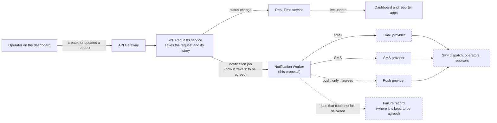

# Proposed Requirements: Notification Worker (`services/notifications/`)

**Status:** Proposed, open for review  |  **Version:** 0.1 (draft)  |  **Objective:** 3

**Author:** Aja Chella Asamba Jr  |  **Reviewers wanted:** owners of `requests` and `realtime`, plus anyone who touches events or privacy

---

## About this document

This is a **proposal**, not a decision. Nothing here is agreed until reviewers have commented and we have settled the disagreements together.

## Key: how to read the tags and terms

Every statement is tagged with where it comes from, so you can tell what is confirmed and what is a guess.

### Where the information comes from

| Tag | What it is | How far to trust it |
|-----|------------|---------------------|
| **[README]** | `README.md`, the project's main description: objectives, glossary, architecture diagram, scenarios | Official project document |
| **[CONTRIBUTING]** | `CONTRIBUTING.md`, the project's rules for contributors: tools, versions, how services must behave | Official project document. Some sections listed in its contents do not exist in the file |
| **[ENV]** | `.env.example`, the template of settings each service reads, including email and SMS settings | Official project file |
| **[PR template]** | `PULL_REQUEST_TEMPLATE.md`, the form every pull request must follow (testing evidence, AI disclosure, no real citizen data) | Official project document |
| **[Code of Conduct]** | `CODE_OF_CONDUCT.md`, the project's behaviour and collaboration rules | Official project document |
| **[PR #1]** | Pull request number 1, an open proposal by another student describing the planned services and flows | **One student's reading. Nobody has reviewed it and it is not an agreed design** |
| **[Research]** | My own research notes on queues, retries, duplicate prevention, messaging providers and local law, produced with an AI tool (Gemini Pro) | **Not yet verified.** Treat as a lead to check, not a fact |
| **[Assumption]** | My own judgement where the project documents say nothing | **Needs reviewers to confirm or correct it** |

### Words used in this document

| Word | What it means here |
|------|--------------------|
| **SPF** | The waste-collection service provider, the organisation that physically collects waste (README glossary) |
| **Request (SPF request)** | A formal order for the SPF to collect waste at a specific location. It moves through the states `REQUESTED`, `ASSIGNED`, `IN_PROGRESS`, `COLLECTED`, or ends as `REJECTED` or `CANCELLED` |
| **Operator** | A municipal staff member who creates and tracks requests on the dashboard |
| **Reporter** | A citizen or field agent who reported the waste |
| **Notification job** | A small message from one service to the worker saying "tell these people about this event" |
| **Queue** | A waiting line for jobs, so the worker handles them one after another, even when many arrive together |
| **Provider** | An outside company that actually delivers the message: an email service or an SMS gateway |
| **Retry** | Trying a failed send again later, with a longer wait each time, and giving up after a limit |
| **Duplicate** | The same message sent to the same person more than once |
| **Failure record** | A list of notifications that could not be delivered, with the reason, so a person can see and act on them |
| **Secret** | A password or key (for example an SMS provider key) that must never be stored in the code |
| **Endpoint** | A web address a program can call. `GET /healthz` is the one that answers "are you working?" |
| **Authority / district** | A municipality or area. The README says each authority should see only its own data |
| **Issue / Pull request** | The two GitHub spaces used by the project: an Issue is a discussion or task, a Pull request is a proposed change to the repository |
| **Acceptance criteria** | The checks that show a requirement has been met |
| **Must / Should / Could** | Priority: Must is essential, Should is important but can wait, Could is a possible extra |
| **Proposed** | Not yet reviewed or agreed. Every requirement here has this status |
| **To be agreed** | A number or decision I have deliberately left open for the group to settle |

---

## 1. What the service is for

When something important happens to a waste-collection request, the right people need to find out, even if they are not looking at the dashboard. The Notification Worker is the part of DWMS that tells them, by email, SMS or push message. It works in the background, so a slow or broken email or SMS provider can never stop an operator from creating or updating a request. **[README]**

## 2. The problem it solves

A request can be created perfectly and still fail in the real world if nobody on the collection side hears about it. Three things go wrong without a dependable notification service:

- **The collection crew is not told.** A request sits in `REQUESTED` and the waste stays where it is.
- **The person who asked is left guessing.** An operator or citizen does not know whether the request was accepted, rejected or completed.
- **Failures are invisible.** If a message silently fails, the dashboard still looks healthy while the real-world work stalls.

The service exists to make sure the right message reaches the right person, once, and that when it cannot, someone can see that it failed. **[Assumption]**, built on the README scenario "SPF notified" when a request is created.

## 3. Who it serves

| Who | What they need from this service | Status |
|-----|----------------------------------|--------|
| **SPF dispatch staff** (the collection provider's office) | Be told straight away when a new request arrives or when one is cancelled | New request: **[README]**. Cancellation: **[Assumption]** |
| **SPF crews / drivers** | A short, clear message with where to go, if the SPF wants crews contacted directly | **[Assumption]**. Is this the same contact as the dispatch desk? |
| **Operators** (municipal staff who create requests) | Know whether their request was assigned, rejected or collected | **[Assumption]** |
| **Reporters** (citizens and field agents) | A closing message when their reported waste is collected | **[Assumption]**. The README only mentions live map updates for this |
| **Municipal administrators** | Confidence that failures are visible, and that people only see their own area | Multi-tenancy: **[README]**. The rest: **[Assumption]** |
| **Other developers** (owners of `requests`, `realtime`) | A clear agreement on what to send the worker and what to expect back | **[PR #1]** lists this as undecided |
| **People whose phone number or email we hold** | Their contact details used only for these messages and not kept longer than needed | **[Assumption]**, see section 7 |

## 4. How it fits into the system

In plain words, the flow proposed in **[PR #1]** and consistent with the README diagram is:

1. An operator creates or updates a request through the gateway.
2. The **SPF Requests** service saves the new state and passes a notification job to the worker.
3. The **Notification Worker** picks up the job, decides who should be told and how, and sends the message through an email or SMS provider.
4. Separately, the **Real-Time** service updates the dashboard. The worker does not do this.

Here is the same flow as a picture. Boxes with a dashed outline are **proposals of mine**, not things the repository confirms.

**What is confirmed and what is not:** the gateway, the SPF Requests service, the Real-Time service and the arrow from SPF Requests to the Notification Worker all appear in the README diagram **[README]**. Everything to the right of the worker (providers, recipients, the failure record) is my proposal, and the way the job travels between SPF Requests and the worker is an open question.

The README diagram shows one arrow, from SPF Requests to the worker, and nothing leaving the worker. How the job travels between the two (a queue, a message, a web call) is **not decided anywhere in the repository**. Section 8 asks for that decision.

**Out of scope for this service:** storing requests or their history, updating the map, live dashboard updates, and a screen where people choose their notification settings.

---

## 5. Proposed functional requirements (what the service must do)

Priority uses **Must / Should / Could**. Every item has the status **Proposed**.

### FR-01: Receive notification jobs from SPF Requests
The service shall accept notification jobs sent by the SPF Requests service.
- **Why:** it is the only way the worker learns that something happened, and it must not read another service's database. **[CONTRIBUTING]**, **[PR #1]**
- **Acceptance criteria:** a valid job sent by SPF Requests is picked up and processed; the worker never reads the `requests` or `locations` database directly.
- **Priority:** Must

### FR-02: Check every job before using it
The service shall check that a job contains everything needed (which request, what changed, who to tell, which channel) and shall refuse a job that is incomplete or malformed.
- **Why:** a bad job should be visible and set aside, not retried forever. **[Research]**
- **Acceptance criteria:** an incomplete job is not sent; it is marked as failed with a clear reason that a developer can read; it does not block other jobs.
- **Priority:** Must

### FR-03: Decide who is told for each change
The service shall use an agreed table of "what happened, who is told, by which channel". The table below is my proposal.
- **Why:** the repository defines the request states but not who hears about each one. **[Assumption]**
- **Acceptance criteria:** for each state in the agreed table, the right recipient receives the right message; no one receives a message the table does not give them.
- **Priority:** Must

| What happened | Who is told | Suggested channel | Basis |
|---------------|-------------|-------------------|-------|
| `REQUESTED` | SPF dispatch | Email and SMS | SPF notified: **[README]**. Channels: proposed |
| `ASSIGNED` | The operator who made the request | Email | Proposed |
| `IN_PROGRESS` | The operator who made the request | Email (optional) | Proposed, Could-have |
| `COLLECTED` | The operator and the original reporter | SMS or email | Proposed. README only mentions the live map |
| `REJECTED` | The operator, with the reason | Email and SMS | Proposed. The operator needs to act |
| `CANCELLED` | SPF dispatch, so a crew does not travel for nothing | Email and SMS | Proposed |

### FR-04: Send email
The service shall send email notifications through a configurable email provider.
- **Why:** email is the written record for detailed updates, and the environment template already provides email settings. **[ENV]**
- **Acceptance criteria:** an email arrives with the correct recipient, subject and content; the provider is chosen by configuration, not code changes.
- **Priority:** Must

### FR-05: Send SMS
The service shall send SMS notifications through a configurable SMS provider.
- **Why:** SMS reaches people without internet access, which matters for field work. The environment template has an SMS provider setting but leaves the provider open. **[ENV]**, **[Assumption]**
- **Acceptance criteria:** an SMS arrives at the right number; phone numbers are converted to one standard format before sending; the provider can be swapped without changing the rest of the service.
- **Priority:** Must. The choice of provider is still open (see section 8).

### FR-06: Send push notifications (to be agreed)
The service could send push notifications to people whose dashboard is closed.
- **Why:** the dashboard already gets live updates through the real-time channel, so push only adds value when the tab is closed. There is no push setup in the environment template, so this is an extension, not a documented need. **[ENV]**, **[Assumption]**
- **Acceptance criteria:** to be written only if reviewers agree push is in scope.
- **Priority:** Could

### FR-07: Retry when a provider is temporarily unavailable
The service shall try again, with a growing delay between attempts, when a provider reports a temporary problem, and shall stop after a limited number of attempts.
- **Why:** providers have short outages, and instant repeated retries make things worse. **[Research]**
- **Acceptance criteria:** a temporary failure leads to a retry after a delay; permanent errors (such as an invalid number) are not retried; after the limit is reached the job is marked as failed (FR-09). The number of attempts and delays are to be agreed.
- **Priority:** Must

### FR-08: Never send the same notification twice
The service shall not send duplicate messages for the same event, even if the same job arrives more than once or the worker restarts mid-send.
- **Why:** repeated messages make people ignore them. At least one repeat is almost certain in a system that retries. **[Research]**
- **Acceptance criteria:** sending the same job twice results in one message; a worker restart does not cause a repeat. The design must also make sure a send that failed can still be retried, so a notification is not wrongly treated as already sent.
- **Priority:** Must

### FR-09: Make failed notifications visible
The service shall keep a record of every notification it could not deliver, with the reason, and shall make final failures easy to notice.
- **Why:** this addresses the "failures are invisible" problem in section 2. PR #1 also asks for a retry and dead-letter policy. **[PR #1]**
- **Acceptance criteria:** after the retry limit, the job appears in a list of failures that a maintainer can read; the record says what failed and why, without containing the message text.
- **Priority:** Must

### FR-10: Record what happened to each notification
The service shall record, for each notification, when it was processed, which channel was used and whether it was handed over to the provider successfully.
- **Why:** it supports debugging and audit. It needs somewhere to be stored, and the repository has no notifications database yet. **[ENV]**, **[Assumption]**
- **Acceptance criteria:** every attempt can be traced from the original request to the provider's answer; the record does not contain full message text or full phone numbers.
- **Priority:** Should

### FR-11: Work without sending real messages in development
The service shall have a development mode that writes messages to the log instead of sending them.
- **Why:** the environment template says providers are left blank in local development and the worker logs instead of sending. **[ENV]**
- **Acceptance criteria:** with the console provider set, no real email or SMS leaves the system and the intended message is visible in the log.
- **Priority:** Must

### FR-12: Keep each authority's notifications separate
The service shall only notify people who belong to the same municipality or district as the request.
- **Why:** the README requires each authority to see only its own area. **[README]**
- **Acceptance criteria:** a request from one district never produces a message to a recipient from another. This needs the job to carry the district (see section 6).
- **Priority:** Should

### FR-13: Write messages in the recipient's language
The service should write messages in French or English depending on the recipient or a default setting.
- **Why:** if this is deployed in Cameroon, both languages are in everyday use. The repository does not say where it is deployed. **[Assumption]**
- **Acceptance criteria:** a recipient set to French gets a French message. SMS text is checked so accents do not make it unexpectedly long or costly.
- **Priority:** Should

### FR-14: Make message content safe
The service shall treat text typed by users (such as location descriptions and names) as plain text and shall not let it change the layout or behaviour of an email.
- **Why:** a person could otherwise put harmful content into a report that ends up in an operator's inbox. **[Research]**
- **Acceptance criteria:** text containing HTML or script characters appears as ordinary text in the email.
- **Priority:** Must

### FR-15: Report its own health
The service shall provide a `GET /healthz` endpoint.
- **Why:** every new service must. **[CONTRIBUTING]**
- **Acceptance criteria:** the endpoint reports healthy when the service can do its work and unhealthy otherwise.
- **Priority:** Must

---

## 6. What this service needs from other services

The worker cannot do its job unless SPF Requests sends it the right information. I propose that each job contains:

- a **unique job ID**, so repeats can be recognised (FR-08);
- the **request ID** and the **new status**;
- the **time** of the change;
- the **district or municipality** (FR-12);
- **who to tell**: either the contact details themselves, or an ID the worker can use to ask for them over an approved route. The worker cannot read the other service's database.

I also ask that SPF Requests makes sure a job is **never lost** if its own save succeeds. **[Research]**, **[Assumption]**. This is the largest dependency on another student's work and needs their agreement.

## 7. Proposed non-functional requirements (how well it must work)

I have **not invented numbers**. Where a target is needed, it says "to be agreed" and suggests how it would be measured.

### NFR-01: Reliability
No accepted notification is silently lost. It is either delivered or recorded as failed.
- **Measure:** after a worker restart or a provider outage, every accepted job ends up delivered or in the failure list.

### NFR-02: Speed
Important messages (such as a new request for SPF) should leave the system soon after the event.
- **Target: to be agreed.** The README promises status updates "within seconds" on the live map but gives no figure for notifications. **[README]**
- **Measure:** time from the job being accepted to being handed to the provider.

### NFR-03: Independence
A slow or broken provider must not slow down or break request creation, or any other service.
- **Measure:** with the providers switched off, SPF Requests still creates and updates requests normally. **[README]** ("async, decoupled")

### NFR-04: Handling busy periods
The service should cope with bursts of events without losing jobs.
- **Target: to be agreed.** We have no expected volumes yet.

### NFR-05: Secrets stay secret
Passwords, API keys and provider credentials are never written into the code or committed to the repository. In production they come from a secret manager.
- **Measure:** a scan of the repository finds none. **[ENV]**, **[CONTRIBUTING]**, the repository `.gitignore`
- **Note:** `.gitignore` covers `.env`, `*.pem`, `*.key` and `secrets/`. Credential files in other formats, such as a JSON key file, need a safe location. **[Assumption]**

### NFR-06: Privacy
Messages and logs contain only what is needed. Phone numbers and emails are masked in logs, and message text is not kept in long-term records.
- **Why:** the service handles personal contact details (phone numbers and email addresses). The PR template rules out committing real citizen data, and CONTRIBUTING lists a Data Privacy Rules section that is not in the file. **[PR template]**, **[CONTRIBUTING]**
- **If the system is used in Cameroon** (the repository does not say): Law No. 2024/017 of 23 December 2024 on personal data protection exists, and its 18-month transition period ended on 23 June 2026, so it should now be fully in force. Public law-firm summaries say that processing is subject to authorisation from the new data protection authority and that sending data abroad needs safeguards. Email and SMS providers are often based abroad, so this could affect which provider we choose. Separately, Article 25 of the 2010 cybersecurity law (Law No. 2010/012) requires network operators and electronic-communication providers to keep connection and traffic data. Some sources say for ten years. I could not confirm that period from the original text, and it is not clear that DWMS counts as such a provider, so the two laws may or may not pull against each other here. **[Research]**, compared with public summaries only, not the original legal texts. This needs checking with someone qualified before it becomes a requirement.

### NFR-07: Traceability
Every notification can be followed from the original request through to the provider's answer using one reference, and the service exposes basic counts (jobs waiting, failures, delivery times) for monitoring.
- **Measure:** given a request ID, a maintainer can find its notification history. **[Research]**

### NFR-08: Easy to change provider
Switching an email or SMS provider is a configuration and small adapter change, not a rewrite.
- **Why:** the SMS provider is undecided, and provider services can change or retire their APIs. **[ENV]**, **[Research]**

### NFR-09: Testable without real providers
The service can be tested automatically without sending real messages or spending SMS credit.
- **Measure:** the test suite runs in CI with fake providers. **[CONTRIBUTING]** lists pytest and `httpx.AsyncClient`.

### NFR-10: Fits the project's rules
The service follows the repository's standards: Python 3.11+, FastAPI plus a worker, a Dockerfile, a Compose entry with pinned versions, and the linting and type checks listed in CONTRIBUTING.
- **Note:** the choice between `arq` and Celery is left open by the repository. I will justify a recommendation separately instead of fixing it as a requirement. **[CONTRIBUTING]**

---

## 8. Open questions for reviewers

| # | Question | Who can help |
|---|----------|--------------|
| 1 | How does a job travel from SPF Requests to the worker (queue, message, web call), and what exactly does it contain? PR #1 says this needs a contract. | `requests` owner, PR #1 author |
| 2 | Is the table in FR-03 right? Who should hear about each status, in particular the reporter on `COLLECTED`? | Everyone, lecturer |
| 3 | Who holds contact details for operators, SPF and reporters? Does the job carry them, or does the worker ask for them? | `requests` owner |
| 4 | `SPF_WEBHOOK_URL` and `SPF_CONTACT_EMAIL` sit under `requests` in the environment template. Does `requests` send some dispatches itself, or does the worker do all of it? | `requests` owner |
| 5 | Should the worker report delivery results back to SPF Requests, and by what route? | `requests` owner |
| 6 | Is push in scope? | Lecturer, `realtime` owner |
| 7 | Which SMS provider, and where will this actually be deployed? The repository does not mention a country. The answer also decides whether the legal points in NFR-06 apply. | Lecturer |
| 8 | May the worker use Redis, and where are delivery records stored? Today only `locations` and `requests` have a database schema. | Everyone |
| 9 | What numbers should we agree for speed, retries and busy periods? | Everyone |
| 10 | Where should the final requirements document live in the repository? | Lecturer, maintainers |

## 9. Sources and limits

- **Repository files used:** README, CONTRIBUTING, CODE_OF_CONDUCT, PULL_REQUEST_TEMPLATE, `.env.example`, `.gitignore`, and the architecture diagram.
- **Gaps in the repository's own documents:** several sections listed in the contents of CONTRIBUTING and README (Testing Requirements, Dependency & Secrets Policy, Data Privacy Rules, Definition of Done, Roadmap, Scaling Limits) are not in the files. I compared the file sizes with a fresh clone of the repository and they match, so this is how the files currently are. Anything those sections would say may change these requirements, and the maintainers may want to know about the gap.
- **PR #1** (`docs/architecture/microservices.md`) is open and has no reviews. I use it only as a proposal.
- **My research notes** cover queueing, retries, duplicate prevention, provider and legal background. I produced them with **Gemini Pro**, so every claim tagged **[Research]** is unverified until checked against its original source. One example of why: an early version of the notes expanded "SPF" as "Service Provider Facility", which the README does not support. This proposal uses the README's definition.
- **AI assistance:** I used **Gemini Pro** for the research phase and **Claude (Anthropic)** to structure and draft this proposal from the research notes, the repository files and my direction. Before posting, the statements taken from repository files were re-checked against those files, and the legal points were compared with public law-firm summaries (not the original legal texts). Where a **[Research]** claim could not be confirmed, it is worded cautiously. Corrections are welcome.

---

## 10. Review log

_To be completed as feedback comes in._

| Date | Reviewer | Comment | Decision |
|------|----------|---------|----------|
|      |          |         |          |
